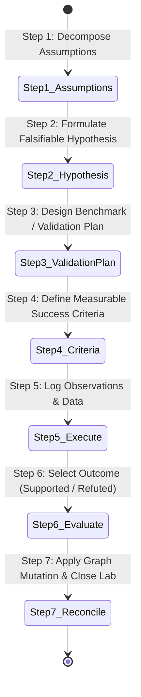

# Design Blueprint: The Cognitive Observatory

**Document Version:** 1.0.0-DESIGN  
**Theme:** The Cognitive Observatory (Dark Cosmic Minimalist)  
**Target Resolution:** Fluid Responsive (Desktop 1440px+ primary, Laptop 1024px+, Tablet 768px+)  
**Framework:** Tailwind CSS v4, shadcn/ui, Radix UI Primitives, Lucide Icons, Framer Motion.

---

## 1. Design Philosophy: The Cognitive Observatory

Web of Thoughts is built for researchers, systems architects, and thinkers engaged in sustained intellectual synthesis. The visual environment must promote:
* **Deep Cognitive Calm:** Absence of aggressive high-contrast white backgrounds or hyper-saturated neons.
* **Semantic Lighting:** Color is used exclusively to denote meaning (relationship types, confidence, empirical verification).
* **Progressive Level-of-Detail (LOD):** Complexity is revealed smoothly based on the user's distance and focus.

```
+-----------------------------------------------------------------------------------+
|  THE COGNITIVE OBSERVATORY PALETTE                                               |
|                                                                                   |
|  [ #080C14 ] Cosmic Background  - Deepest spatial background                     |
|  [ #0D131F ] Ground Shell       - Application frame & navigation sidebar          |
|  [ #131B2E ] Surface Card       - Node cards, discovery panels, inspector         |
|  [ #1A243D ] Elevated Surface   - Modals, tooltips, active popovers               |
|                                                                                   |
|  [ #8B5CF6 ] Luminous Violet    - Autonomous Discoveries & Cross-Domain Analogies|
|  [ #06B6D4 ] Electric Cyan      - Causal & Enabling Relationships                 |
|  [ #10B981 ] Emerald Green      - Empirically Verified Hypotheses & Facts         |
|  [ #F59E0B ] Amber Gold         - Unverified Assumptions & Topological Gaps       |
|  [ #F43F5E ] Vibrant Rose       - Contradictions & Disputed Assertions            |
+-----------------------------------------------------------------------------------+
```

---

## 2. Complete Design Tokens

### 2.1 Color Tokens (Tailwind CSS v4 Configuration)

```css
@theme {
  --color-cosmic-950: #080C14;
  --color-cosmic-900: #0D131F;
  --color-cosmic-800: #131B2E;
  --color-cosmic-700: #1A243D;
  --color-cosmic-600: #263352;

  --color-text-primary: #F8FAFC;
  --color-text-secondary: #94A3B8;
  --color-text-muted: #64748B;

  --color-discovery: #8B5CF6;
  --color-discovery-glow: rgba(139, 92, 246, 0.25);

  --color-causal: #06B6D4;
  --color-verified: #10B981;
  --color-warning: #F59E0B;
  --color-conflict: #F43F5E;

  --border-subtle: rgba(255, 255, 255, 0.08);
  --border-strong: rgba(255, 255, 255, 0.16);
}
```

### 2.2 Typography Hierarchy
* **Display & Canvas Headers:** *Inter Display* or *Plus Jakarta Sans*, weights 600–700, letter-spacing `-0.02em`.
* **Body & Inspector Text:** *Inter*, regular weight, leading 1.6, color `--color-text-secondary`.
* **Technical Metadata & Citations:** *JetBrains Mono*, weight 500, letter-spacing `0.02em` for hash values, line numbers, scores, and confidence percentages.

### 2.3 Spatial Scale & Radii
* **Grid Base Unit:** 4px.
* **Component Radii:**
  * Pill Badges: `rounded-full` (`9999px`)
  * Buttons & Form Inputs: `rounded-md` (`6px`)
  * Node Cards & Dropdowns: `rounded-xl` (`12px`)
  * Modals & Discovery Lab Panels: `rounded-2xl` (`16px`)
* **Shadows & Glows:**
  * Standard Card: `box-shadow: 0 4px 20px -2px rgba(0, 0, 0, 0.5)`
  * Discovery Glow: `box-shadow: 0 0 25px -4px rgba(139, 92, 246, 0.35)`

---

## 3. UI Component Architecture and Layout Specification

### 3.1 3-Column Responsive Application Shell

```
+----------------------------------------------------------------------------------------------------+
|  HEADER: [Logo: Web of Thoughts]   [Search / Cmd+K]   [Fast Capture +]   [User Profile / BYOK Key] |
+----------------------+-------------------------------------------------------+---------------------+
| LEFT PANEL (260px)   | CENTER CANVAS & LAB (Flex-1)                          | RIGHT PANEL (380px) |
|                      |                                                       |                     |
| [Tab: Discoveries]   | +-- VIEW TOGGLE: [ Knowledge Canvas | Discovery Lab ] | [ Selected Entity ] |
|  - Card 1: Raft/Bees | |                                                     | Concept: Raft       |
|  - Card 2: Butyrate  | |   (Interactive React Flow Node Canvas)              | Domain: Dist. Sys   |
|                      | |                                                     | Connections: 8      |
| [Tab: Graph Filters] | |        [Node A] ---------> [Node B]                 | Status: Accepted    |
|  - All Domains (4)   | |            \                 /                      |                     |
|  - Edges: Verified   | |             \               /                       | [ Verbatim Evidence]|
|  - Timeline: 2026    | |              [Discovery ?]                          | "Raft ensures..."   |
|                      | |                                                     | (Chunk #3, offset)  |
| [Active Labs (2)]    | +-----------------------------------------------------+                     |
|  * Parkinson's Spike |                                                       | [Promote to Lab]    |
+----------------------+-------------------------------------------------------+---------------------+
```

* **Left Sidebar (260px Fixed):** Ingestion feed, active discovery candidate queue, domain cluster filters, and historical timeline slider.
* **Center Viewport (Fluid):** Primary high-performance React Flow canvas. Features a floating top control bar for switching between Global Canvas and Active Discovery Lab view.
* **Right Contextual Inspector (380px Collapsible):** Expands on selection to display verbatim source evidence, confidence meters, relationship type pickers, and mutation audit logs.

---

## 4. Interactive Graph Visualization Language

### 4.1 Node Visual Structure (`ConceptNode`)

```
+----------------------------------------------------------------+
|  [o] COMPUTING CLUSTER                           Conf: 94%     |  <- Header
|  Distributed Raft Consensus                                    |  <- Canonical Title
|  Leader election and log replication algorithm...              |  <- Short Description
|----------------------------------------------------------------|
|  6 Edges   |   2 Sources   |   [Status: Accepted (Green)]      |  <- Footer
+----------------------------------------------------------------+
```

### 4.2 Progressive Level-of-Detail (LOD) Behavior
* **Far Zoom (< 0.4x):** Individual node cards fade out. Nodes collapse into glowing colored circular discs sized by degree centrality. Visualizes macro-clusters and isolated islands.
* **Mid Zoom (0.4x - 0.9x):** Nodes render as compact rounded capsules containing the domain badge and canonical name. Edge lines and directional arrows are visible.
* **Close Zoom (> 0.9x):** Full interactive node card expands, revealing connection counts, evidence chips, and clickable action triggers.

### 4.3 Safety & Policy Visual Indicators: Non-Stigmatizing Design
* **Natural Domain Coloring:** Sensitive concepts (e.g., malware analysis, vulnerability mechanisms) retain their standard domain category colors (`#06B6D4` for Computing, `#8B5CF6` for Biology). The canvas **never** stains sensitive nodes red.
* **Permitted Scope Badge in Inspector:** When an entity operates under `ALLOW_WITH_LIMITS`, a clean pill badge appears: `Scope: Defensive / Conceptual`. Clicking it opens the permitted scope drawer detailing allowed research vs restricted operational execution.
* **Constructive Refusal Prompts:** Refusal responses are styled with a subtle border (`rgba(244, 63, 94, 0.3)`), avoiding lecturing language and immediately offering clickable safe alternative research questions.

---

## 5. Discovery Lab User Experience & State Machine UI

The Discovery Lab is designed as a focused, distraction-free investigation workbench. The full conceptual workflow spans 11 steps (documented in [06-ai-and-discovery-engine.md](research/06-ai-and-discovery-engine.md)), but the **MVP UI consolidates these into 7 actionable stages** to reduce cognitive overhead:



> [!NOTE]
> Steps 1 (Select) and 2 (Understand) from the full 11-step protocol happen implicitly when the user clicks "Investigate" on a discovery card. Step 5 (Unanswered Questions) and Step 6 (Collect Evidence) from the full protocol are accessible via the Evidence Inspector panel at any point during the investigation, not as separate linear stages. This consolidation reduces the MVP UI to 7 explicit steps while preserving all analytical capabilities.

### Discovery Lab Visual Elements:
1. **Hypothesis Builder Card:** Provides guided prompt assistance (*"If [Variable X] is applied to [Context Y], then [Metric Z] will change by [Threshold] because [Mechanism]"*).
2. **Assumption Checklist:** Toggleable cards where the user marks which foundational assumptions have been proven vs. unverified.
3. **Observation Console:** Clean markdown editor with code-block support for pasting terminal logs, benchmark numbers, or lab assay results.
4. **Resolution Banner:** Prominent modal confirming graph reconciliation (*"Hypothesis Supported: New verified edge 'Honeybee Stigmergy analogous_to Raft Consensus' written to Knowledge Graph"*).

---

## 6. Motion Specification & Transitions

* **Spring Physics Tokens (Framer Motion):**
  ```typescript
  export const springTransitions = {
    cardSpring: { type: "spring", stiffness: 400, damping: 32 },
    panelSlide: { type: "spring", stiffness: 300, damping: 28 },
    layoutTransition: { duration: 0.6, ease: [0.16, 1, 0.3, 1] }
  };
  ```
* **Accessibility Override:** In all animation hooks, check `window.matchMedia('(prefers-reduced-motion: reduce)')`. When true, transitions fall back to instant `duration: 0` swaps.
