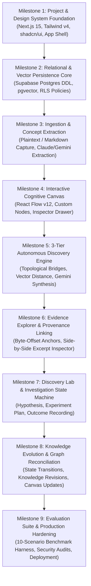

# Implementation Roadmap: Web of Thoughts

**Document Version:** 1.0.0-ROADMAP  
**Date:** 2026-10-26  
**Strategy:** Disciplined Vertical Slice (Minimum Complete Intellectual Loop First)  
**Execution Methodology:** Spec-Driven Development (GSD Loop: Discuss $\rightarrow$ Plan $\rightarrow$ Execute $\rightarrow$ Verify $\rightarrow$ Ship)

---

## 1. Vertical-Slice Execution Strategy

Rather than building horizontal layers in isolation (e.g., building a complete database, then a complete backend, then a complete UI months later without end-to-end testing), Web of Thoughts follows a **Vertical-Slice Strategy**:

Each milestone delivers a testable, demonstrable capability that links the full stack from database to visual user interface.

---

## 2. Milestone Breakdown and Engineering Specifications

### Milestone 1: Project & Design System Foundation
* **Goal:** Initialize the Next.js 15 application shell, establish TypeScript strict typing, configure Tailwind CSS v4 design tokens, and scaffold the "Cognitive Observatory" 3-column layout.
* **Features:** 3-column responsive layout, theme tokens (`#080C14` cosmic background, luminous violet/cyan/emerald accents), accessible header, modal overlays.
* **Affected Modules / Directories:**
  * `app/layout.tsx`, `app/page.tsx`
  * `components/ui/*` (Button, Dialog, Drawer, Badge, Tooltip)
  * `styles/globals.css`, `tailwind.config.ts`
  * `types/global.d.ts`
* **Dependencies:** Node.js 20+, Next.js 15, Tailwind CSS v4, Lucide React, Radix UI.
* **Implementation Tasks:**
  1. Initialize Next.js with App Router and TypeScript.
  2. Install and configure `shadcn/ui` with customized dark cosmic palette tokens.
  3. Construct the 3-column layout shell (`NavSidebar`, `MainCanvasArea`, `InspectorPanel`).
  4. Implement `prefers-reduced-motion` detection hooks.
* **Testing Requirements:** Responsive layout rendering tests across viewport widths (1440px, 1024px, 768px); zero hydration mismatch errors.
* **Acceptance Criteria:** Application loads instantly in dark theme; navigation, empty center canvas, and inspector drawer open and close smoothly.
* **Common Failure Modes:** Hydration mismatches caused by browser theme detection; improper flexbox sizing collapsing the center canvas.
* **Completion Conditions:** Clean `pnpm build` with zero TypeScript or linting errors.

---

### Milestone 2: Relational & Vector Persistence Core
* **Goal:** Deploy the PostgreSQL 16 schema with `pgvector`, establish connection pooling via Supabase, and enforce Row-Level Security (RLS) on all tables.
* **Features:** Relational schema tables (`sources`, `source_chunks`, `concepts`, `relationships`, `evidence_records`, `discovery_candidates`, `investigations`, `hypotheses`, `experiment_plans`, `knowledge_revisions`), HNSW vector index, RLS policies.
* **Affected Modules / Directories:**
  * `supabase/migrations/*`
  * `lib/db/client.ts`, `lib/db/schema.ts`
  * `types/database.ts`
* **Dependencies:** Milestone 1, Supabase CLI, PostgreSQL 16.
* **Implementation Tasks:**
  1. Write and apply migration scripts for all 10 core tables and indexes.
  2. Configure Supabase client with typed database definitions.
  3. Implement RLS policies ensuring strict multi-tenant isolation (`auth.uid() = user_id`).
  4. Write SQL tests verifying that cross-tenant queries fail with permission errors.
* **Testing Requirements:** Automated SQL unit tests verifying foreign key cascades, HNSW index cosine distance queries, and RLS isolation.
* **Acceptance Criteria:** `pnpm test:db` passes; cross-user data access is cryptographically blocked.
* **Common Failure Modes:** Forgetting RLS on a join table; missing vector extension in local development environment.
* **Completion Conditions:** Migrations run cleanly on fresh database; schema types generated automatically via Supabase CLI.

---

### Milestone 3: Ingestion, Extraction & Safety Engine Pipeline
* **Goal:** Build the ingestion modal for raw text and Markdown, implement token chunking, integrate the Safety & Policy Engine interceptor, and extract atomic concepts and typed relationships via LLM.
* **Features:** Fast capture modal, text hashing, token chunker (500 tokens), Safety & Policy assessment gate (5 outcomes), prompt injection boundary isolation, structured JSON extraction via Claude 3.5 Sonnet / Gemini 1.5 Pro.
* **Affected Modules / Directories:**
  * `components/capture/CaptureModal.tsx`
  * `app/api/ingest/route.ts`
  * `lib/safety/policyEngine.ts`, `lib/safety/rules.ts`
  * `lib/ai/extractor.ts`, `lib/ai/prompts/extraction.ts`
  * `lib/ai/embeddings.ts`
* **Dependencies:** Milestones 1 & 2, Anthropic / Google AI SDKs, OpenAI embedding API.
* **Implementation Tasks:**
  1. Build `CaptureModal` with character counter and instant submission.
  2. Implement backend route handler `/api/ingest` with SHA-256 deduplication.
  3. Implement token chunking with character start/end offset calculations.
  4. Integrate `SafetyPolicyEngine` evaluating inputs with 5-outcome model (`ALLOW`, `ALLOW_WITH_LIMITS`, etc.) and logging to `safety_assessments`.
  5. Wrap untrusted document text in XML delimiters to neutralize indirect prompt injection.
  6. Build structured LLM extraction prompt enforcing Zod schema output for concepts and relationships.
  7. Compute vector embeddings and persist records in `concepts` and `relationships`.
* **Testing Requirements:** Vitest unit tests for text chunker and byte offset accuracy; prompt injection resilience tests; mock tests for LLM extraction parsing.
* **Acceptance Criteria:** Pasting a 1,000-word research note evaluates safety, neutralizes injections, and extracts 4–8 concepts and 3–6 typed relationships into PostgreSQL within 4 seconds.
* **Common Failure Modes:** LLM hallucinating relationships between concepts not mentioned in the source; JSON syntax errors from unescaped markdown quotes.
* **Completion Conditions:** Extracted concepts, relationships, and safety assessment records persist with correct foreign keys.

---

### Milestone 4: Interactive Cognitive Canvas
* **Goal:** Implement the high-performance 2D interactive canvas using `@xyflow/react` with custom styled concept nodes and typed relationship edges.
* **Features:** Pan, zoom, node selection, custom `ConceptNode` component, directional typed edges with semantic coloring, inspector drawer synchronization.
* **Affected Modules / Directories:**
  * `components/canvas/KnowledgeCanvas.tsx`
  * `components/canvas/nodes/ConceptNode.tsx`
  * `components/canvas/edges/TypedEdge.tsx`
  * `components/inspector/InspectorPanel.tsx`
  * `stores/canvasStore.ts`
* **Dependencies:** Milestones 1, 2, & 3, `@xyflow/react`.
* **Implementation Tasks:**
  1. Integrate React Flow canvas inside the center viewport.
  2. Implement custom `ConceptNode` rendering domain badge, canonical name, degree count, and confidence glow.
  3. Implement custom `TypedEdge` with SVG marker ends and semantic colors (`causes`, `contradicts`, `analogous_to`).
  4. Bind node/edge selection events to Zustand store to drive the Inspector Panel.
  5. Integrate Web Worker force-directed layout computation for non-overlapping node placement.
* **Testing Requirements:** Component tests for node click handlers; rendering stress test with 500 mock nodes maintaining $\ge 50$ FPS.
* **Acceptance Criteria:** Nodes and edges render accurately from database records; clicking a node displays its properties in the Inspector within 50ms.
* **Common Failure Modes:** React re-render loops caused by unmemoized node arrays; layout worker crashes on disconnected graphs.
* **Completion Conditions:** Fluid canvas navigation with responsive zooming, panning, and selection.

---

### Milestone 5: 3-Tier Autonomous Discovery Engine
* **Goal:** Implement the multi-tier discovery pipeline that identifies cross-domain bridges, computes novelty/plausibility scores, and surfaces ranked discovery candidates.
* **Features:** Topological candidate filtering, pgvector intermediate cosine similarity scan ($0.45 \le \text{Cosine} \le 0.75$), Tier 3 LLM synthesis prompt, discovery candidate queue in Left Sidebar.
* **Affected Modules / Directories:**
  * `app/api/discover/scan/route.ts`
  * `lib/discovery/topology.ts`, `lib/discovery/vectorScan.ts`, `lib/discovery/synthesizer.ts`
  * `components/navigation/DiscoveryFeed.tsx`
  * `components/discovery/DiscoveryCard.tsx`
* **Dependencies:** Milestones 2, 3, & 4.
* **Implementation Tasks:**
  1. Build SQL query to isolate cross-domain concept pairs lacking existing direct edges.
  2. Implement pgvector cosine distance filtering for the "Goldilocks Zone".
  3. Implement Tier 3 synthesis prompt (Gemini 1.5 Pro) evaluating structural analogy and tension.
  4. Compute composite ranking score and persist top candidates in `discovery_candidates`.
  5. Build `DiscoveryFeed` in sidebar displaying unread discovery cards with score badges.
* **Testing Requirements:** Benchmark test verifying that cross-domain analogies pass Tier 3 while obvious same-domain pairs are dismissed.
* **Acceptance Criteria:** Ingesting notes from two distinct domains automatically produces a ranked discovery card explaining the structural bridge.
* **Common Failure Modes:** Discovery engine generating trivial connections; timeout on vector queries without proper index.
* **Completion Conditions:** Proactive discovery candidates render with explanations, novelty scores, and action buttons ("Investigate", "Dismiss").

---

### Milestone 6: Evidence Explorer & Provenance Linking
* **Goal:** Guarantee complete citation integrity by linking discovery claims to verbatim source excerpts with byte-offset highlighting.
* **Features:** Evidence record extraction, side-by-side source excerpt comparison in Inspector, byte-for-byte citation verification.
* **Affected Modules / Directories:**
  * `components/inspector/EvidenceViewer.tsx`
  * `components/inspector/ExcerptHighlighter.tsx`
  * `lib/provenance/offsetMatcher.ts`
* **Dependencies:** Milestones 3 & 5.
* **Implementation Tasks:**
  1. Implement exact string offset locator matching LLM quotes against stored `source_chunks`.
  2. Render side-by-side evidence cards in the Inspector when a discovery candidate is selected.
  3. Add visual highlight styling (`bg-violet-900/40 text-violet-200`) over the exact excerpt within the full source note view.
  4. Enforce strict anti-hallucination check: if quoted text is not found verbatim in the source chunk, discard the citation.
* **Testing Requirements:** Automated string matching tests with special characters, unicode, and whitespace variations.
* **Acceptance Criteria:** Clicking any citation in a discovery card instantly displays the original source text with the exact evidence highlighted.
* **Common Failure Modes:** Character offset drift when source notes contain Windows `\r\n` vs Unix `\n` line endings.
* **Completion Conditions:** 100% of generated citations link directly to verifiable source excerpts.

---

### Milestone 7: Discovery Lab & Investigation State Machine
* **Goal:** Build the empirical investigation workbench that guides users from discovery to testable hypothesis, experiment plan, and outcome recording.
* **Features:** Discovery Lab view toggle, 11-step investigation state machine, assumption builder, falsifiable hypothesis form, experiment plan logger, outcome selector (`Supported`/`Refuted`).
* **Affected Modules / Directories:**
  * `app/lab/[id]/page.tsx`
  * `components/lab/InvestigationWorkbench.tsx`
  * `components/lab/HypothesisBuilder.tsx`
  * `components/lab/ExperimentPlanForm.tsx`
  * `components/lab/ObservationLogger.tsx`
  * `stores/investigationStore.ts`
* **Dependencies:** Milestones 4, 5, & 6.
* **Implementation Tasks:**
  1. Build route `/lab/[id]` and workbench layout.
  2. Implement state machine transitions (`hypothesis` $\rightarrow$ `design` $\rightarrow$ `execution` $\rightarrow$ `evaluation`).
  3. Build guided hypothesis form with assumption tags and variable inputs.
  4. Build experiment plan editor with success criteria thresholds.
  5. Implement observation logger with markdown/code block support.
  6. Implement final evaluation modal to record `Supported`, `Refuted`, or `Inconclusive`.
* **Testing Requirements:** State machine transition tests; form validation tests ensuring hypotheses cannot be submitted without success criteria.
* **Acceptance Criteria:** User can promote a discovery into the Lab, complete an investigation plan, log observations, and submit a final verdict.
* **Common Failure Modes:** Complex multi-step forms causing user drop-off; unsaved form state on accidental navigation.
* **Completion Conditions:** Complete investigation workflow successfully records data in `investigations`, `hypotheses`, and `experiment_plans`.

---

### Milestone 8: Knowledge Evolution & Graph Reconciliation
* **Goal:** Close the knowledge loop by updating the canonical knowledge graph based on Discovery Lab investigation outcomes.
* **Features:** Automatic edge status mutation (`proposed` $\rightarrow$ `accepted` or `rejected`), edge styling update on canvas, `knowledge_revisions` audit logging.
* **Affected Modules / Directories:**
  * `app/api/lab/reconcile/route.ts`
  * `lib/graph/reconciler.ts`
  * `components/canvas/edges/EdgeStatusBadge.tsx`
* **Dependencies:** Milestones 4 & 7.
* **Implementation Tasks:**
  1. Implement reconciliation Server Action executing atomic database transaction.
  2. If outcome is `Supported`: update relationship status to `accepted`, set confidence to 0.95, and link investigation ID.
  3. If outcome is `Refuted`: update relationship status to `rejected`, muting the edge on canvas and adding negative feedback penalty to engine.
  4. Write entry to `knowledge_revisions` detailing previous state, new state, and reason.
  5. Trigger optimistic UI update in React Flow canvas to immediately reflect the new edge appearance.
* **Testing Requirements:** Transaction rollback tests ensuring graph mutations fail safely if revision logging fails.
* **Acceptance Criteria:** Marking an investigation as `Supported` turns the dashed discovery edge on the canvas into a solid emerald green verified edge.
* **Common Failure Modes:** Race conditions between simultaneous investigation updates; UI failing to refresh without hard reload.
* **Completion Conditions:** The 8-stage lifecycle (Capture $\rightarrow$ Learn) is fully closed and verifiable in the application.

---

### Milestone 9: Evaluation Suite, Safety Audits & Deployment
* **Goal:** Execute the 10-scenario cross-domain evaluation benchmark and 12-category safety & policy test suite, conduct security audits, and deploy the application to production infrastructure.
* **Features:** Automated cross-domain benchmark runner, 12-category safety evaluation harness (`ST-01` through `ST-12`), SSRF protection filters, token rate limiters, Vercel / Supabase production deployment.
* **Affected Modules / Directories:**
  * `tests/benchmark/crossDomainSuite.test.ts`
  * `tests/safety/policyBenchmark.test.ts`
  * `middleware.ts` (Rate limiting & Auth guards)
  * `.env.production.example`
* **Dependencies:** All prior milestones.
* **Implementation Tasks:**
  1. Implement the Vitest benchmark runner executing all 10 synthetic cross-domain test cases (`TC-01` through `TC-10`).
  2. Implement the safety evaluation test runner executing all 12 synthetic policy test cases (`ST-01` through `ST-12`), verifying zero overblocking of defensive research and 100% refusal of actionable harm scripts.
  3. Verify that benchmark passes with $\ge 80\%$ True Positive recall and zero hallucinated citations.
  4. Audit all database RLS policies against cross-tenant injection attacks.
  5. Configure rate limiting on AI endpoints using Upstash Redis or token bucket middleware.
  6. Deploy to Vercel (Frontend/API) and Supabase (Postgres/Auth/Storage).
* **Testing Requirements:** End-to-end integration tests using Playwright; full security penetration and prompt injection test pass; safety test suite execution.
* **Acceptance Criteria:** All cross-domain and safety benchmark scenarios pass; deployment builds cleanly on production servers; security audit passes with zero critical findings.
* **Common Failure Modes:** Environment variable misconfigurations on production host; cold start latency on serverless edge functions.
* **Completion Conditions:** Production URL live, fully functional, and verified against all Scope A acceptance criteria.
