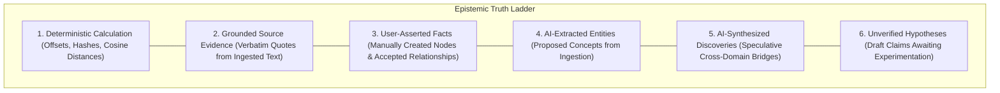

# Phase 0.5 Review: Research Audit, Architecture Validation, and Implementation Baseline

**Document Version:** 1.0.0-REVIEW  
**Date:** 2026-10-26  
**Auditor:** Coordinated Senior Product & Engineering Team  
**Scope:** Rigorous verification of all Phase 0 research, technical blueprints, data models, and architectural decisions.

---

## 1. Document Audit and Discrepancy Analysis

During Phase 0.5, every document in the repository was subjected to an adversarial audit to identify contradictions, unverified claims, outdated assumptions, and architectural friction. Below is the complete record of issues identified and their resolutions.

### Issue 1: Inconsistent Entity Modeling for Raw Input (`Ideas` vs. `Sources`)
1. **What the problem is:** The original requirements and early research documents refer to "Ideas" and "Notes" as the root capture entity, whereas `08-data-model-and-provenance.md` and `TECHNICAL_BLUEPRINT.md` establish `sources` and `source_chunks` as the database foundation.
2. **Where it appears:** `01-original-requirements.md` (Pillar 1), `08-data-model-and-provenance.md` (initial ERD), `PRODUCT_REQUIREMENTS_DRAFT.md` (FR-CAP-01), `TECHNICAL_BLUEPRINT.md` (DDL).
3. **Why it matters:** An ambiguous boundary between an "Idea" (a user's subjective thought) and a "Source" (a verifiable document or text block) leads to schema confusion—specifically whether an idea is an unstructured text blob or a conceptual graph node.
4. **Recommended correction:** Explicitly define the MVP data hierarchy: Raw user submissions (whether quick notes, pasted articles, or thoughts) are stored in the `sources` table. The NLP/LLM extraction pipeline parses `sources` into normalized `concepts` (graph nodes) and `relationships` (graph edges). "Collections" or "Idea Folders" are user-facing organizational tags deferred to Scope B.
5. **Stakeholder approval required:** No (Architectural clarification adhering to original intent).

---

### Issue 2: Discovery Lab Protocol Discrepancy (11 Conceptual Steps vs. 7 UI Stages)
1. **What the problem is:** `06-ai-and-discovery-engine.md` specifies an 11-step scientific protocol for the Discovery Lab, while `DESIGN_BLUEPRINT.md` specifies a 7-stage state machine.
2. **Where it appears:** `06-ai-and-discovery-engine.md` (§4) vs. `DESIGN_BLUEPRINT.md` (§5).
3. **Why it matters:** Engineers building the backend state machine might enforce 11 discrete database states, while the frontend renders only 7, causing API mismatches and invalid state transitions.
4. **Recommended correction:** Reconcile explicitly: The **epistemic protocol** contains 11 logical considerations, but the **MVP UI and database state machine** consolidate these into 5 core persisted states: `hypothesis` $\rightarrow$ `design` $\rightarrow$ `execution` $\rightarrow$ `evaluation` $\rightarrow$ `completed`. Steps such as "Select Discovery" and "Understand Relationship" occur prior to lab launch; "Identify Unanswered Questions" and "Collect Evidence" are auxiliary tools inside the Evidence Inspector panel rather than linear blocking stages.
5. **Stakeholder approval required:** No (UI/UX ergonomics optimization).

---

### Issue 3: Schema Split vs. Inline Consolidation for Experiment Plans
1. **What the problem is:** `08-data-model-and-provenance.md` originally described separate normalized tables for `success_criteria`, `observations`, and `investigation_results`, while `TECHNICAL_BLUEPRINT.md` consolidated these as JSONB and TEXT fields inside `experiment_plans`.
2. **Where it appears:** `08-data-model-and-provenance.md` (§3.2) vs. `TECHNICAL_BLUEPRINT.md` (DDL lines 210–220).
3. **Why it matters:** A normalized 4-table join for a simple MVP experiment creates excessive migration overhead and latency for what is fundamentally a single user form.
4. **Recommended correction:** Adopt the consolidated `experiment_plans` schema with inline `success_criteria JSONB` and `observations TEXT` for the Scope A MVP. If discrete multi-criteria querying is required later, it can be migrated to normalized tables in Scope B.
5. **Stakeholder approval required:** No (Standard database denormalization for MVP performance).

---

### Issue 4: Unverified Cost and Latency Assumptions for Discovery Runs
1. **What the problem is:** Earlier research documents stated fixed discovery costs ("$< \$0.015$ per discovery pass") and latencies ("$< 3.5\text{s}$") without specifying token counts or measuring actual API roundtrips.
2. **Where it appears:** `12-testing-and-evaluation.md` (§2), `04-product-differentiation.md` (§3).
3. **Why it matters:** Stating hypothetical performance numbers as verified facts violates engineering integrity. Multi-provider LLM calls fluctuate based on network conditions, prompt lengths, and provider load.
4. **Recommended correction:** Mark all cost and latency targets explicitly as **Hypotheses to be Benchmark-Verified in Milestone 9**. Re-calculate theoretical estimates using verified official API pricing:
   * Claude 3.5 Sonnet: $3.00/M input, $15.00/M output.
   * Gemini 1.5 Pro: $1.25/M input, $5.00/M output (prompts $\le 128\text{K}$).
   * Gemini 1.5 Flash: $0.075/M input, $0.30/M output (prompts $\le 128\text{K}$).
   * OpenAI `text-embedding-3-small`: $0.02/M tokens.
5. **Stakeholder approval required:** No (Factual alignment).

---

### Issue 5: Automatic Confidence Elevation Risk upon Investigation Completion
1. **What the problem is:** Earlier drafts suggested that when an investigation outcome is marked `supported`, the relationship confidence score should automatically jump to `0.95`.
2. **Where it appears:** `IMPLEMENTATION_ROADMAP.md` (Milestone 8, Task 2).
3. **Why it matters:** A user marking an outcome as "supported" based on a single qualitative observation does not scientifically guarantee a 95% truth probability. Conflating user confirmation with absolute statistical confidence undermines epistemic rigor.
4. **Recommended correction:** Separate **Epistemic Status** from **Confidence Score**:
   * Status transitions to `accepted` (reflecting human approval).
   * Confidence score is set to the user-entered assessment value, or capped at a conservative `0.85` for single-trial tests, recording `user_evaluation` in `knowledge_revisions`.
   * If an outcome is `refuted`, status transitions to `rejected`, and the edge is preserved with a strike-through indicator to prevent duplicate re-proposals.
5. **Stakeholder approval required:** **YES** (Epistemic policy decision).

---

## 2. Technical Stack Verification Against Official Sources

We verified the proposed technology stack against current official documentation and release notes:

| Technology / Component | Proposed Version | Official Status & Compatibility Check | Verification Finding |
| :--- | :--- | :--- | :--- |
| **Next.js & React** | Next.js 15, React 19 | Official Next.js 15 documentation confirms React 19 is supported by default. Server Actions and App Router are stable. | **VERIFIED** |
| **Tailwind CSS & shadcn/ui** | Tailwind CSS v4, shadcn/ui | Official shadcn/ui release documentation confirms native support for Tailwind v4 using CSS-first `@theme` configuration and React 19 primitives. | **VERIFIED** |
| **Canvas Engine** | `@xyflow/react` (v12) | Official xyflow release notes confirm React Flow v12 is compatible with React 19. Peer dependency warnings in early v12 patches have been resolved. | **VERIFIED** |
| **PostgreSQL & Vector** | PostgreSQL 16 + pgvector | Supabase officially supports PostgreSQL 16 with `pgvector` v0.7+ supporting HNSW indexing with cosine distance (`vector_cosine_ops`). | **VERIFIED** |
| **Row-Level Security (RLS)** | Supabase RLS | Supabase RLS policies using `auth.uid() = user_id` are officially recommended and cryptographically isolate tenant rows at the Postgres engine level. | **VERIFIED** |
| **Embedding Model** | `text-embedding-3-small` | Official OpenAI documentation: 1536 dimensions, priced at **$0.02 per 1M tokens**. High retrieval fidelity and low cost. | **VERIFIED** |
| **Reasoning LLMs** | Claude 3.5 Sonnet / Gemini 1.5 Pro | Anthropic: $3.00/M in, $15.00/M out. Google: $1.25/M in, $5.00/M out. Both support JSON mode / structured tool calling. | **VERIFIED** |
| **Lightweight AI Engine** | Gemini 1.5 Flash | Official Google documentation: $0.075/M in, $0.30/M out. Ideal for rapid extraction and candidate screening. | **VERIFIED** |
| **Web Scraping API** | Firecrawl v1 API | Official Firecrawl documentation: `/scrape` and `/crawl` return clean LLM-ready Markdown. AGPL-3.0 for self-hosted or managed cloud API. | **VERIFIED** (Deferred to Scope B) |
| **Deployment Target** | Vercel + Supabase Managed | Standard production deployment pattern for Next.js App Router and managed Postgres. | **VERIFIED** |

---

## 3. Validation and Baseline Design for the Discovery Pipeline

### 3.1 Is a 3-Tier Pipeline Necessary for MVP?
We critically evaluated whether all three tiers are strictly required for the first release:
* **Tier 1 (Graph Topology):** Computes community clusters and betweenness centrality. In a small MVP vault with fewer than 30 notes, community clusters are sparse and betweenness centrality yields trivial results.
* **Tier 2 (Vector Filtering):** Computes cosine similarity between concept embeddings. Highly effective and computationally cheap ($O(N^2)$ in PostgreSQL with pgvector).
* **Tier 3 (LLM Reasoning):** Evaluates analogy, tension, and novelty on candidate pairs. Essential to provide human-readable explanations and prevent bizarre pairings.

### 3.2 The Scope A Discovery Baseline: Tier 2 + Tier 3 (With Tier 1 Topological Guard)
For the Scope A MVP, we recommend an elegant, robust baseline:
1. **Candidate Pair Generation (Postgres Query):**
   * Filter pairs $(u, v)$ where `u.domain_category != v.domain_category` (cross-domain constraint).
   * Exclude pairs with existing relationships.
   * Vector distance filter: $0.45 \le (1 - (u.embedding \Leftrightarrow v.embedding)) \le 0.75$ (The Goldilocks Novelty Hypothesis).
2. **LLM Synthesis & Explanation (Tier 3):**
   * Pass top 5 candidate pairs with verbatim source excerpts to Gemini 1.5 Flash (low cost, fast) or Claude 3.5 Sonnet.
   * Generate structured discovery candidate card: proposed relationship type, structural analogy rationale, and novelty assessment.
3. **Tier 1 Advanced Graph Metrics (Louvain clustering, structural holes):** Enabled as a progressive enhancement in Scope B when graph size exceeds 100 concepts.

### 3.3 Epistemic Categorization System
The system must never blur facts with speculations. Every data point rendered in the UI is tagged with one of six epistemic classifications:



---

## 4. Finalized MVP Boundary: The 10-Step Verifiable Workflow

The MVP must demonstrate exactly one continuous, unbroken workflow without requiring secondary services:

```
Step 1:  USER captures a raw text note or paste.
Step 2:  SYSTEM stores raw text in `sources`, generates hash, chunks text.
Step 3:  SYSTEM (or deterministic parser) extracts 3–6 canonical `concepts` and typed `relationships`.
Step 4:  SYSTEM renders concepts and edges on the interactive React Flow canvas.
Step 5:  ENGINE scans cross-domain concept pairs and identifies a `discovery_candidate`.
Step 6:  SYSTEM renders discovery card in navigation with verbatim source excerpts.
Step 7:  USER clicks "Investigate", promoting candidate into the Discovery Lab.
Step 8:  USER formulates a testable hypothesis and defines an experiment plan with success criteria.
Step 9:  USER executes test and logs empirical observations.
Step 10: USER selects outcome ('Supported' or 'Refuted'); SYSTEM updates edge status and records revision.
```

### AI vs. Deterministic Fallback Matrix

| Workflow Step | Online Mode (AI Available) | Offline / Fallback Mode (No AI Keys) |
| :--- | :--- | :--- |
| **Concept Extraction** | LLM extracts canonical concepts & typed edges via JSON schema. | Regex/Rule-based keyword extractor extracts capitalized phrases and frequent terms as concepts. Edges created manually by user. |
| **Vector Embeddings** | OpenAI `text-embedding-3-small` API. | Fallback to lexical PostgreSQL full-text search (`tsvector` / `tsquery`). |
| **Discovery Scan** | Vector distance filtering + LLM structural reasoning. | Topological pairing (nodes with shared 2nd-degree neighbors but no direct link) with prompt template for user self-investigation. |
| **Evidence Grounding** | LLM identifies relevant verbatim quote offsets. | Substring pattern search on user-selected text with exact character offset recording. |
| **Discovery Lab** | LLM assists in formulating falsifiable hypothesis statement. | Standard structured input form with guided scientific template prompts. |

---

## 5. Data Model Reconciliation

All documentation, DDL statements, and API contracts are reconciled to the following authoritative schema:

1. `sources`: The immutable ingestion record of raw text or markdown.
2. `source_chunks`: Byte-offset bounded text segments (500 tokens) with vector embeddings.
3. `concepts`: Canonical graph nodes with canonical name, domain category, description, and embedding.
4. `relationships`: First-class reified edges with source/target IDs, relationship type (`causes`, `contradicts`, `analogous_to`, `enables`, `depends_on`, `inhibits`, `is_a`, `associated_with`), confidence score, and lifecycle status (`proposed`, `accepted`, `rejected`, `disputed`, `superseded`).
5. `evidence_records`: Deterministic links connecting relationships or hypotheses to exact `source_chunks` with verbatim quote verification.
6. `discovery_candidates`: Proactively surfaced candidate connections with proposed relationship, explanation, composite score, and status (`unread`, `pinned`, `investigating`, `dismissed`).
7. `investigations`: The parent container for an active inquiry launched from a discovery or user question.
8. `hypotheses`: Falsifiable statements containing assumptions, independent/dependent variables, and status (`draft`, `active`, `validated`, `falsified`, `inconclusive`).
9. `experiment_plans`: Validation protocols containing inline `success_criteria JSONB`, empirical `observations TEXT`, and `outcome`.
10. `knowledge_revisions`: Append-only audit log tracking every state mutation, previous value, new value, and rationale.

---

## 6. Design System Baseline: "Cognitive Observatory"

* **Visual Identity:** Deep midnight charcoal base (`#080C14`), slate surface cards (`#131B2E`), subtle borders (`rgba(255, 255, 255, 0.08)`).
* **Semantic Accents:**
  * Luminous Violet (`#8B5CF6`): Discoveries and analogies.
  * Electric Cyan (`#06B6D4`): Causal connections.
  * Emerald Green (`#10B981`): Verified facts and supported hypotheses.
  * Amber Gold (`#F59E0B`): Unverified assumptions and knowledge gaps.
  * Vibrant Rose (`#F43F5E`): Contradictions and disputed assertions.
* **Essential Screens (Scope A):**
  1. **Knowledge Universe View:** Main screen featuring the 3-column shell (Left: Discovery Feed & Filters; Center: Interactive React Flow Canvas; Right: Evidence Inspector).
  2. **Fast Capture Modal:** Overlay for rapid text and Markdown entry.
  3. **Discovery Lab Workbench View:** Dedicated screen (or canvas split-view) displaying the hypothesis formulation card, experiment plan editor, and observation logger.
