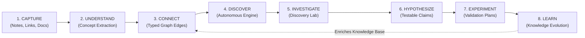

# Research Master Report: Web of Thoughts

**Document Version:** 1.0.0-RESEARCH  
**Date:** 2026-10-26  
**Status:** Complete / Ready for Review  
**Project Phase:** Phase 0 (Deep Research, Product Intelligence, and Engineering Blueprint)

---

## Executive Summary

Web of Thoughts is an intelligent, knowledge-centric platform engineered to address the fundamental limitations of modern personal knowledge management (PKM) and conversational artificial intelligence. Today's knowledge workers and researchers are caught between two inadequate paradigms:

1. **Static, Manual Note Repositories (Obsidian, Notion, Capacities):** Demand unsustainable manual tagging and linking. Their graph views inevitably devolve into unnavigable "hairballs," and over 90% of captured notes are never revisited or connected.
2. **Stateless Conversational AI (ChatGPT, Claude, NotebookLM):** Offer impressive ad-hoc document synthesis, but their insights are trapped inside ephemeral chat sessions that vanish into scrolling history logs without compounding into a persistent knowledge base.

Web of Thoughts unifies these paradigms into an **active research collaborator**. Grounded in our selected product direction—**Path C: Autonomous Discovery Engine + Discovery Lab**—the product couples a persistent, typed knowledge graph with a proactive background discovery engine and a structured, empirical investigation workbench.

---

## Key Findings Across Research Domains

### 1. Market Intelligence & Competitive Defensibility
Our analysis of 8 key competitors (Obsidian, TheBrain, Heptabase, Capacities, Tana, Kumu, NotebookLM, and ChatGPT Projects) revealed an unaddressed market vacuum:
* **No tool bridges topological graph analysis with an empirical experiment tracking loop.** Obsidian and TheBrain map links; NotebookLM grounds answers; Kumu measures network metrics; but none autonomously identify cross-domain structural isomorphisms and guide the user through a formal hypothesis falsification funnel.
* **The "Why Not ChatGPT + Obsidian?" Test:** Standard vector search plugins in Obsidian rely on cosine similarity, surfacing only semantically obvious connections (e.g., "Photosynthesis" connects to "Chloroplasts"). Web of Thoughts combines **deterministic graph topology (structural holes and bridging centrality)** with intermediate vector distance filtering ($0.45 \le \text{Cosine} \le 0.75$) and LLM reasoning to discover non-obvious, high-surprise cross-domain breakthroughs.

### 2. Autonomous Discovery & Anti-Hallucination Pipeline
Prompting an LLM with thousands of notes in a raw prompt is economically unviable and prone to hallucinated relationships. Web of Thoughts solves this through a **3-Tier Hybrid Discovery Pipeline**:
* **Tier 1 (Graph Topology):** Runs community detection (Louvain) and betweenness centrality directly in PostgreSQL to isolate candidate cluster bridges.
* **Tier 2 (Vector Filtering):** Screens candidate pairs via `pgvector` to identify the "Goldilocks Zone" of conceptual novelty.
* **Tier 3 (Constrained LLM Synthesis):** Passes only candidate pairs and verifiable source chunks into an LLM (Claude 3.5 Sonnet / Gemini 1.5 Pro) to extract structural analogies, tension, novelty, and plausibility scores.
* **Zero Hallucinated Citations:** Every assertion in the system maintains deterministic byte-offset anchors back to original source text chunks.

### 3. The Discovery Lab & Knowledge Evolution
Discoveries are useless without execution. The **Discovery Lab** provides an 11-step structured investigation state machine:
$$\text{Discovery} \rightarrow \text{Assumptions} \rightarrow \text{Testable Hypothesis} \rightarrow \text{Validation Plan} \rightarrow \text{Success Metrics} \rightarrow \text{Observations} \rightarrow \text{Outcome Evaluation}$$
Crucially, investigation outcomes reconcile back into the persistent graph: supported hypotheses elevate edges to `status: accepted`; disproven hypotheses mark edges as `status: rejected`, preventing duplicate recommendations and creating an evolving, self-correcting institutional memory.

### 4. Technical Architecture & Stack Selection
* **Frontend:** Next.js 15 App Router, React 19, TypeScript, Tailwind CSS v4, and `shadcn/ui`.
* **Interactive Canvas:** **`@xyflow/react` (React Flow v12)** paired with **`graphology`** in a Web Worker for smooth force-directed layout computation without UI thread blocking.
* **Backend & Persistence:** **PostgreSQL 16 via Supabase** with `pgvector` for embeddings, recursive Common Table Expressions (CTEs) for graph traversals, and Row-Level Security (RLS) for cryptographically enforced multi-tenant data isolation.
* **Web & Document Ingestion:** **Firecrawl API** for turning dynamic web pages and complex PDFs into token-optimized, clean Markdown.

---

## Detailed Research Index

For complete evidentiary documentation, refer to the individual research monographs in the `research/` directory:

| Research Monograph | Core Focus & Contents |
| :--- | :--- |
| **[01-original-requirements.md](research/01-original-requirements.md)** | Original vision extraction, 9 baseline pillars, Path C definition, 8-stage lifecycle. |
| **[02-market-and-competitor-analysis.md](research/02-market-and-competitor-analysis.md)** | 12-point audit of 8 competitors, feature comparison matrix, defensibility analysis. |
| **[03-user-research-and-use-cases.md](research/03-user-research-and-use-cases.md)** | Target personas, 4 user friction bottlenecks, 3 concrete cross-domain walkthroughs, JTBD. |
| **[04-product-differentiation.md](research/04-product-differentiation.md)** | The "Aha!" moment, knowledge flywheel, defense against frontier model commoditization. |
| **[05-open-source-and-repository-research.md](research/05-open-source-and-repository-research.md)** | Audit of 12 candidate repos/skills (GSD, Superpowers, Firecrawl, TasteSkill, etc.). |
| **[06-ai-and-discovery-engine.md](research/06-ai-and-discovery-engine.md)** | 3-Tier Discovery Pipeline, Goldilocks vector zone, Evidence Explorer, 11-step Lab protocol. |
| **[07-technical-architecture.md](research/07-technical-architecture.md)** | Full stack evaluation, React Flow vs. WebGL, Postgres/pgvector, graceful offline degradation. |
| **[08-data-model-and-provenance.md](research/08-data-model-and-provenance.md)** | Complete PostgreSQL schema, reified edges, Mermaid ERD, RLS policies. |
| **[09-design-system-and-experience.md](research/09-design-system-and-experience.md)** | "Cognitive Observatory" design system, color tokens, 3-column layout, LOD graph zoom. |
| **[10-security-privacy-and-reliability.md](research/10-security-privacy-and-reliability.md)** | Indirect prompt injection defense, multi-tenant RLS, SSRF prevention, GDPR export/erasure. |
| **[11-mvp-scope-and-roadmap.md](research/11-mvp-scope-and-roadmap.md)** | Scope A (MVP), Scope B (Demo), Scope C (Future Vision), feature risk matrix. |
| **[12-testing-and-evaluation.md](research/12-testing-and-evaluation.md)** | Objective quality metrics, 10-case cross-domain benchmark suite, automated CI test harness. |
| **[13-decisions-and-open-questions.md](research/13-decisions-and-open-questions.md)** | 5 core architectural decisions pending stakeholder approval, design trade-offs. |
| **[14-research-sources.md](research/14-research-sources.md)** | Formal evidentiary bibliography with URLs, publisher details, claims, and verified limitations. |
| **[SAFETY_AND_POLICY_ENGINE.md](SAFETY_AND_POLICY_ENGINE.md)** | First-class cross-cutting safety engine specification, 5-outcome policy model, 12-suite evaluation. |

---

## Critical Decisions Pending Approval

Before beginning Phase 1 implementation, the engineering team requests explicit stakeholder confirmation on the following five foundational choices:

1. **Graph Canvas Engine:** Adoption of **`@xyflow/react` (React Flow v12)** with a background Web Worker layout algorithm for high-craft interactive cards.
2. **Database Architecture:** Adoption of **PostgreSQL 16 via Supabase** with `pgvector` and recursive CTEs rather than maintaining a separate NoSQL graph database.
3. **AI Provider Abstraction:** Dual-provider support for **Anthropic Claude 3.5 Sonnet** and **Google Gemini 1.5 Pro** with Bring-Your-Own-Key (BYOK) encryption.
4. **Ingestion Engine:** Integration of **Firecrawl API** for Scope B web/PDF scraping, with native text/markdown ingestion for Scope A.
5. **Scope A MVP Feature Boundary:** Limiting the initial implementation strictly to text capture, concept extraction, 2D interactive canvas, 3-Tier discovery generation, basic evidence anchoring, and single-hypothesis Discovery Lab validation.
