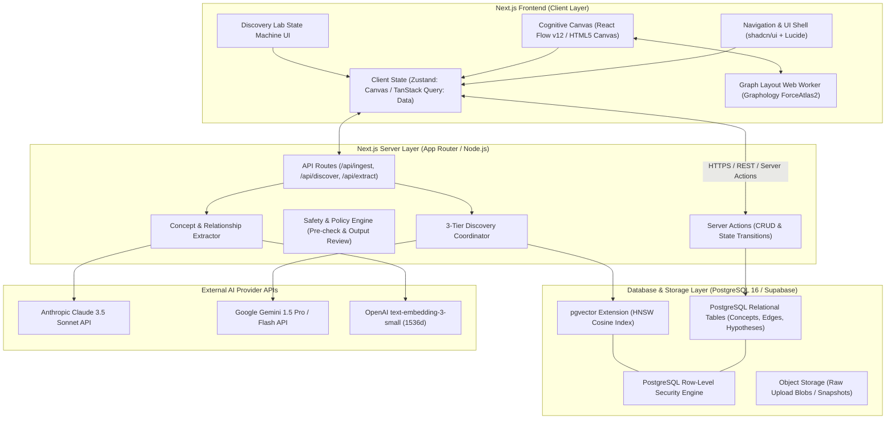

# Technical Blueprint and System Architecture

**Document Version:** 1.0.0-BLUEPRINT  
**Date:** 2026-10-26  
**Status:** Architecture Frozen for Implementation  
**Tech Stack:** Next.js 15 (App Router), React 19, TypeScript 5.5+, Tailwind CSS v4, shadcn/ui, React Flow v12, PostgreSQL 16 + pgvector, Supabase.

---

## 1. End-to-End System Architecture



---

## 2. Database Schema DDL (PostgreSQL 16 + pgvector)

```sql
-- Enable necessary extensions
CREATE EXTENSION IF NOT EXISTS "uuid-ossp";
CREATE EXTENSION IF NOT EXISTS "pgcrypto";
CREATE EXTENSION IF NOT EXISTS "vector";

-- NOTE: In the MVP (Scope A), raw user input is captured directly as 'sources'.
-- A separate 'ideas' table and 'collections' grouping mechanism are deferred to
-- Scope B, where users can organize sources into named collections.
-- The ERD in 08-data-model-and-provenance.md documents this deferral.

--------------------------------------------------------------------------------
-- 1. SOURCES & CHUNKS (Provenance Foundation)
--------------------------------------------------------------------------------
CREATE TABLE IF NOT EXISTS public.sources (
    id UUID PRIMARY KEY DEFAULT gen_random_uuid(),
    user_id UUID NOT NULL REFERENCES auth.users(id) ON DELETE CASCADE,
    title TEXT NOT NULL,
    source_type TEXT NOT NULL CHECK (source_type IN ('text', 'markdown', 'pdf', 'url')),
    uri TEXT,
    content_hash TEXT NOT NULL,
    metadata JSONB DEFAULT '{}'::jsonb,
    created_at TIMESTAMPTZ NOT NULL DEFAULT timezone('utc'::text, now()),
    updated_at TIMESTAMPTZ NOT NULL DEFAULT timezone('utc'::text, now())
);

CREATE INDEX idx_sources_user_id ON public.sources(user_id);
CREATE INDEX idx_sources_hash ON public.sources(user_id, content_hash);

CREATE TABLE IF NOT EXISTS public.source_chunks (
    id UUID PRIMARY KEY DEFAULT gen_random_uuid(),
    source_id UUID NOT NULL REFERENCES public.sources(id) ON DELETE CASCADE,
    user_id UUID NOT NULL REFERENCES auth.users(id) ON DELETE CASCADE,
    chunk_index INT NOT NULL,
    content TEXT NOT NULL,
    start_char INT NOT NULL,
    end_char INT NOT NULL,
    embedding vector(1536),
    created_at TIMESTAMPTZ NOT NULL DEFAULT timezone('utc'::text, now())
);

CREATE INDEX idx_chunks_source ON public.source_chunks(source_id, chunk_index);
CREATE INDEX idx_chunks_embedding ON public.source_chunks USING hnsw (embedding vector_cosine_ops);

--------------------------------------------------------------------------------
-- 2. CONCEPTS & REIFIED RELATIONSHIPS (Knowledge Graph)
--------------------------------------------------------------------------------
CREATE TABLE IF NOT EXISTS public.concepts (
    id UUID PRIMARY KEY DEFAULT gen_random_uuid(),
    user_id UUID NOT NULL REFERENCES auth.users(id) ON DELETE CASCADE,
    canonical_name TEXT NOT NULL,
    aliases TEXT[] DEFAULT ARRAY[]::TEXT[],
    description TEXT,
    domain_category TEXT NOT NULL DEFAULT 'General',
    embedding vector(1536),
    color TEXT DEFAULT '#8B5CF6',
    created_at TIMESTAMPTZ NOT NULL DEFAULT timezone('utc'::text, now()),
    updated_at TIMESTAMPTZ NOT NULL DEFAULT timezone('utc'::text, now()),
    CONSTRAINT uq_user_concept UNIQUE (user_id, canonical_name)
);

CREATE INDEX idx_concepts_user_domain ON public.concepts(user_id, domain_category);
CREATE INDEX idx_concepts_embedding ON public.concepts USING hnsw (embedding vector_cosine_ops);

CREATE TABLE IF NOT EXISTS public.relationships (
    id UUID PRIMARY KEY DEFAULT gen_random_uuid(),
    user_id UUID NOT NULL REFERENCES auth.users(id) ON DELETE CASCADE,
    source_concept_id UUID NOT NULL REFERENCES public.concepts(id) ON DELETE CASCADE,
    target_concept_id UUID NOT NULL REFERENCES public.concepts(id) ON DELETE CASCADE,
    relationship_type TEXT NOT NULL CHECK (relationship_type IN (
        'causes', 'contradicts', 'analogous_to', 'enables', 'depends_on', 'inhibits', 'is_a', 'associated_with'
    )),
    directional BOOLEAN NOT NULL DEFAULT TRUE,
    confidence_score NUMERIC(3,2) NOT NULL DEFAULT 0.75 CHECK (confidence_score >= 0.00 AND confidence_score <= 1.00),
    status TEXT NOT NULL DEFAULT 'proposed' CHECK (status IN (
        'proposed', 'accepted', 'rejected', 'disputed', 'superseded'
    )),
    rationale TEXT,
    created_at TIMESTAMPTZ NOT NULL DEFAULT timezone('utc'::text, now()),
    updated_at TIMESTAMPTZ NOT NULL DEFAULT timezone('utc'::text, now()),
    CONSTRAINT chk_no_self_edges CHECK (source_concept_id != target_concept_id)
);

CREATE INDEX idx_rel_user_concepts ON public.relationships(user_id, source_concept_id, target_concept_id);
CREATE INDEX idx_rel_status ON public.relationships(user_id, status);

CREATE TABLE IF NOT EXISTS public.evidence_records (
    id UUID PRIMARY KEY DEFAULT gen_random_uuid(),
    user_id UUID NOT NULL REFERENCES auth.users(id) ON DELETE CASCADE,
    relationship_id UUID REFERENCES public.relationships(id) ON DELETE CASCADE,
    source_chunk_id UUID NOT NULL REFERENCES public.source_chunks(id) ON DELETE CASCADE,
    verbatim_quote TEXT NOT NULL,
    stance TEXT NOT NULL CHECK (stance IN ('supports', 'refutes', 'neutral')),
    created_at TIMESTAMPTZ NOT NULL DEFAULT timezone('utc'::text, now())
);

CREATE INDEX idx_evidence_rel ON public.evidence_records(relationship_id);

--------------------------------------------------------------------------------
-- 3. AUTONOMOUS DISCOVERY & DISCOVERY LAB (Investigation Workflow)
--------------------------------------------------------------------------------
CREATE TABLE IF NOT EXISTS public.discovery_candidates (
    id UUID PRIMARY KEY DEFAULT gen_random_uuid(),
    user_id UUID NOT NULL REFERENCES auth.users(id) ON DELETE CASCADE,
    concept_a_id UUID NOT NULL REFERENCES public.concepts(id) ON DELETE CASCADE,
    concept_b_id UUID NOT NULL REFERENCES public.concepts(id) ON DELETE CASCADE,
    discovery_type TEXT NOT NULL CHECK (discovery_type IN (
        'cross_domain_analogy', 'structural_hole_bridge', 'latent_contradiction', 'knowledge_gap'
    )),
    proposed_relationship TEXT NOT NULL,
    explanation TEXT NOT NULL,
    novelty_score NUMERIC(3,2) NOT NULL CHECK (novelty_score >= 0.0 AND novelty_score <= 1.0),
    plausibility_score NUMERIC(3,2) NOT NULL CHECK (plausibility_score >= 0.0 AND plausibility_score <= 1.0),
    composite_score NUMERIC(3,2) NOT NULL CHECK (composite_score >= 0.0 AND composite_score <= 1.0),
    status TEXT NOT NULL DEFAULT 'unread' CHECK (status IN (
        'unread', 'pinned', 'investigating', 'dismissed'
    )),
    created_at TIMESTAMPTZ NOT NULL DEFAULT timezone('utc'::text, now())
);

CREATE INDEX idx_disc_user_composite ON public.discovery_candidates(user_id, status, composite_score DESC);

CREATE TABLE IF NOT EXISTS public.investigations (
    id UUID PRIMARY KEY DEFAULT gen_random_uuid(),
    user_id UUID NOT NULL REFERENCES auth.users(id) ON DELETE CASCADE,
    discovery_id UUID REFERENCES public.discovery_candidates(id) ON DELETE SET NULL,
    title TEXT NOT NULL,
    summary TEXT,
    stage TEXT NOT NULL DEFAULT 'hypothesis' CHECK (stage IN (
        'hypothesis', 'design', 'execution', 'evaluation', 'completed'
    )),
    created_at TIMESTAMPTZ NOT NULL DEFAULT timezone('utc'::text, now()),
    updated_at TIMESTAMPTZ NOT NULL DEFAULT timezone('utc'::text, now())
);

CREATE TABLE IF NOT EXISTS public.hypotheses (
    id UUID PRIMARY KEY DEFAULT gen_random_uuid(),
    investigation_id UUID NOT NULL REFERENCES public.investigations(id) ON DELETE CASCADE,
    user_id UUID NOT NULL REFERENCES auth.users(id) ON DELETE CASCADE,
    statement TEXT NOT NULL,
    assumptions TEXT[] DEFAULT ARRAY[]::TEXT[],
    status TEXT NOT NULL DEFAULT 'draft' CHECK (status IN (
        'draft', 'active', 'validated', 'falsified', 'inconclusive'
    )),
    created_at TIMESTAMPTZ NOT NULL DEFAULT timezone('utc'::text, now())
);

CREATE TABLE IF NOT EXISTS public.experiment_plans (
    id UUID PRIMARY KEY DEFAULT gen_random_uuid(),
    hypothesis_id UUID NOT NULL REFERENCES public.hypotheses(id) ON DELETE CASCADE,
    title TEXT NOT NULL,
    methodology TEXT NOT NULL,
    success_criteria JSONB NOT NULL DEFAULT '[]'::jsonb,
    observations TEXT,
    outcome TEXT CHECK (outcome IN ('supported', 'refuted', 'inconclusive')),
    created_at TIMESTAMPTZ NOT NULL DEFAULT timezone('utc'::text, now()),
    completed_at TIMESTAMPTZ
);

CREATE TABLE IF NOT EXISTS public.knowledge_revisions (
    id UUID PRIMARY KEY DEFAULT gen_random_uuid(),
    user_id UUID NOT NULL REFERENCES auth.users(id) ON DELETE CASCADE,
    entity_type TEXT NOT NULL CHECK (entity_type IN ('concept', 'relationship', 'hypothesis')),
    entity_id UUID NOT NULL,
    previous_state JSONB NOT NULL,
    new_state JSONB NOT NULL,
    reason TEXT NOT NULL,
    created_at TIMESTAMPTZ NOT NULL DEFAULT timezone('utc'::text, now())
);

--------------------------------------------------------------------------------
-- 4. SAFETY & POLICY ASSESSMENTS
--------------------------------------------------------------------------------
CREATE TABLE IF NOT EXISTS public.safety_assessments (
    id UUID PRIMARY KEY DEFAULT gen_random_uuid(),
    user_id UUID NOT NULL REFERENCES auth.users(id) ON DELETE CASCADE,
    target_entity_type TEXT NOT NULL CHECK (target_entity_type IN ('source', 'concept', 'discovery', 'investigation', 'experiment')),
    target_entity_id UUID NOT NULL,
    policy_version TEXT NOT NULL DEFAULT 'v1.0',
    decision TEXT NOT NULL CHECK (decision IN ('ALLOW', 'ALLOW_WITH_LIMITS', 'CLARIFY', 'REFUSE_AND_REDIRECT', 'BLOCK_SPECIFIC_OPERATION')),
    category TEXT NOT NULL CHECK (category IN ('benign', 'cybersecurity_defensive', 'cybersecurity_offensive', 'cbrn', 'harmful_action', 'dual_use_research', 'ambiguous')),
    rationale_summary TEXT NOT NULL,
    permitted_scope TEXT,
    assessment_method TEXT NOT NULL CHECK (assessment_method IN ('deterministic_rule', 'llm_classifier', 'fallback_default')),
    created_at TIMESTAMPTZ NOT NULL DEFAULT timezone('utc'::text, now())
);

CREATE INDEX idx_safety_user_target ON public.safety_assessments(user_id, target_entity_type, target_entity_id);

--------------------------------------------------------------------------------
-- 5. ROW-LEVEL SECURITY ENFORCEMENT
--------------------------------------------------------------------------------
ALTER TABLE public.sources ENABLE ROW LEVEL SECURITY;
ALTER TABLE public.source_chunks ENABLE ROW LEVEL SECURITY;
ALTER TABLE public.concepts ENABLE ROW LEVEL SECURITY;
ALTER TABLE public.relationships ENABLE ROW LEVEL SECURITY;
ALTER TABLE public.evidence_records ENABLE ROW LEVEL SECURITY;
ALTER TABLE public.discovery_candidates ENABLE ROW LEVEL SECURITY;
ALTER TABLE public.investigations ENABLE ROW LEVEL SECURITY;
ALTER TABLE public.hypotheses ENABLE ROW LEVEL SECURITY;
ALTER TABLE public.experiment_plans ENABLE ROW LEVEL SECURITY;
ALTER TABLE public.knowledge_revisions ENABLE ROW LEVEL SECURITY;
ALTER TABLE public.safety_assessments ENABLE ROW LEVEL SECURITY;

CREATE POLICY "Users own their sources" ON public.sources FOR ALL USING (auth.uid() = user_id) WITH CHECK (auth.uid() = user_id);
CREATE POLICY "Users own their source_chunks" ON public.source_chunks FOR ALL USING (auth.uid() = user_id) WITH CHECK (auth.uid() = user_id);
CREATE POLICY "Users own their concepts" ON public.concepts FOR ALL USING (auth.uid() = user_id) WITH CHECK (auth.uid() = user_id);
CREATE POLICY "Users own their relationships" ON public.relationships FOR ALL USING (auth.uid() = user_id) WITH CHECK (auth.uid() = user_id);
CREATE POLICY "Users own their evidence_records" ON public.evidence_records FOR ALL USING (auth.uid() = user_id) WITH CHECK (auth.uid() = user_id);
CREATE POLICY "Users own their discovery_candidates" ON public.discovery_candidates FOR ALL USING (auth.uid() = user_id) WITH CHECK (auth.uid() = user_id);
CREATE POLICY "Users own their investigations" ON public.investigations FOR ALL USING (auth.uid() = user_id) WITH CHECK (auth.uid() = user_id);
CREATE POLICY "Users own their hypotheses" ON public.hypotheses FOR ALL USING (auth.uid() = user_id) WITH CHECK (auth.uid() = user_id);
CREATE POLICY "Users own their experiment_plans" ON public.experiment_plans FOR ALL USING (auth.uid() = (SELECT user_id FROM public.hypotheses WHERE id = experiment_plans.hypothesis_id));
CREATE POLICY "Users own their knowledge_revisions" ON public.knowledge_revisions FOR ALL USING (auth.uid() = user_id) WITH CHECK (auth.uid() = user_id);
CREATE POLICY "Users view own safety assessments" ON public.safety_assessments FOR SELECT USING (auth.uid() = user_id);
CREATE POLICY "Users insert own safety assessments" ON public.safety_assessments FOR INSERT WITH CHECK (auth.uid() = user_id);
```

---

## 3. Core API Specifications

### 3.1 Ingestion & Extraction Endpoint
* **Path:** `POST /api/ingest`
* **Request Payload:**
  ```json
  {
    "title": "Notes on Raft Consensus and Leases",
    "source_type": "text",
    "content": "Raft ensures state consistency across distributed replicas using leader election..."
  }
  ```
* **Processing Steps:**
  1. Hash content (SHA-256) and check for duplicates.
  2. Create record in `sources`.
  3. Chunk content into 500-token blocks; compute embeddings via `text-embedding-3-small`.
  4. Trigger `extractConceptsAndRelations()` via Claude 3.5 Sonnet using JSON schema.
  5. Upsert concepts and insert `relationships` with `status: 'proposed'`.
  6. Trigger asynchronous discovery evaluation pass.
* **Response Payload (200 OK):**
  ```json
  {
    "source_id": "9b1deb4d-3b7d-4bad-9bdd-2b0d7b3dcb6d",
    "extracted_concepts": [
      { "id": "1111...", "canonical_name": "Raft Consensus", "domain": "Distributed Systems" }
    ],
    "extracted_relationships": [
      { "id": "2222...", "type": "enables", "confidence": 0.92 }
    ]
  }
  ```

### 3.2 Discovery Candidate Generation Endpoint
* **Path:** `POST /api/discover/scan`
* **Algorithm:**
  1. Query pairs of concepts $(u, v)$ where:
     * `u.user_id = v.user_id = auth.uid()`
     * `u.domain_category != v.domain_category` (Cross-domain constraint)
     * No existing relationship in `relationships`.
     * `0.45 <= (1 - (u.embedding <=> v.embedding)) <= 0.75` (Goldilocks vector zone).
  2. For top 5 candidate pairs, invoke Gemini 1.5 Pro to evaluate structural analogy and tension.
  3. Calculate composite score:
     $$\text{Score} = 0.25 \times \text{Novelty} + 0.25 \times \text{Plausibility} + 0.20 \times \text{Topology} + 0.20 \times \text{Grounding} - 0.30 \times \text{DismissalPenalty}$$
  4. Persist candidates exceeding $0.60$ threshold into `discovery_candidates`.

---

## 4. Graph Visualization Engine Specification

### 4.1 React Flow Custom Node Architecture
Each node on the canvas is rendered as a custom React component (`ConceptNodeComponent`):
* **Handle Positions:** Dynamic 4-quadrant handles (`Top`, `Right`, `Bottom`, `Left`) to support optimal orthogonal and bezier routing.
* **Visual States:**
  * `idle`: Deep slate background (`#131B2E`), subtle 1px border.
  * `hovered`: Luminous violet glow (`box-shadow: 0 0 15px rgba(139, 92, 246, 0.3)`).
  * `selected`: Bold 2px border, contextual action badges expanded.
  * `investigating`: Pulsing emerald border indicating an active Discovery Lab session.

### 4.2 Web Worker Force-Directed Layout
To prevent main thread jank during layout rearrangements:
* **Library:** `graphology` and `graphology-layout-forceatlas2`.
* **Execution:** A dedicated Web Worker (`layout.worker.ts`) receives the graph topology (nodes + edge weights), iterates 200 simulation steps, and posts back updated $(x, y)$ coordinate arrays.
* **Animation:** Canvas interpolates nodes to their new coordinates using Framer Motion springs over 600ms.
