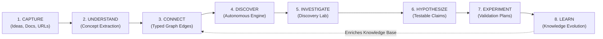

# 01. Original Requirements and Product Vision

## 1. Executive Summary of Product Intent

**Web of Thoughts** is an intelligent, knowledge-centric platform conceived to transcend static note-taking, disjointed mind-mapping, and ephemeral AI chat interfaces. The fundamental premise of the product is that human ideas, research materials, and intellectual observations do not exist in isolation; they form a dense, evolving conceptual tapestry. However, existing personal knowledge management (PKM) tools place an unsustainable cognitive burden on users to manually tag, link, and maintain these relationships, while modern conversational LLM tools provide isolated, session-bound insights that vanish into conversational history without enriching a cumulative knowledge base.

Web of Thoughts solves this paradigm failure by establishing a **persistent, self-evolving knowledge foundation** paired with proactive intelligence. The application continuously captures unstructured ideas, extracts semantic concepts, constructs a typed and verifiable knowledge graph, visualizes conceptual topologies, and autonomously discovers non-obvious cross-domain relationships that are then systematically investigated through an empirical, hypothesis-driven workflow.

---

## 2. Extraction and Preservation of Original Vision

The original vision encompasses nine core functional pillars. Each pillar is documented below with its baseline requirements and operational implications:

| Pillar | Original Requirement | Architectural & User Experience Implication |
| :--- | :--- | :--- |
| **1. Information Capture** | Capturing raw ideas, unstructured notes, documents (PDF, Markdown), external links, and structured references. | Frictionless ingestion pipeline supporting mixed media without forcing premature folder hierarchies or rigid classifications. |
| **2. Concept Extraction** | Extracting meaningful, normalized concepts, entities, and arguments from submitted information. | Automated Natural Language Processing (NLP) / LLM semantic extraction pipeline that identifies entities while avoiding vocabulary explosion or redundant synonyms. |
| **3. Persistent Knowledge Graph** | Organizing extracted concepts into a durable, multi-tenant knowledge graph foundation. | Relational/graph persistence layer where concepts are first-class entities with canonical identities, attributes, and temporal metadata. |
| **4. Relationship Identification** | Identifying meaningful, typed relationships between concepts (e.g., *causes, contradicts, enables, generalizes, depends-on*). | Edges are not merely visual lines; they carry semantic types, provenance, confidence scores, and bidirectional contextual meanings. |
| **5. Interactive Knowledge Universe** | Visualizing relationships through an interactive, navigable knowledge universe. | High-performance graph canvas supporting zooming, panning, clustering, node inspection, and level-of-detail rendering without visual clutter. |
| **6. Search, Filter, and Exploration** | Searching, filtering, and exploring connected concepts across topological neighborhoods and semantic spaces. | Hybrid retrieval combining full-text lexical search, semantic vector similarity, and multi-hop graph neighborhood traversals. |
| **7. Unexpected Discovery** | Discovering non-obvious, surprising, and serendipitous relationships between disparate concepts. | Algorithmic and generative discovery engine identifying cross-cluster bridges, structural holes, and latent analogies across different domains. |
| **8. Explainable Relationships** | Explaining why proposed relationships matter, providing clear contextual rationale and source grounding. | Every proposed connection must supply a transparent, human-readable rationale grounded in verifiable evidence, preventing hallucinated associations. |
| **9. Continuous Graph Maintenance** | Maintaining and updating the graph as the user's knowledge base grows, evolves, and changes over time. | Autonomous reconciliation, deduplication, conflict detection, and lifecycle management (updating, superseding, or archiving outdated assertions). |

---

## 3. The Selected Product Direction: Path C

The selected strategic direction for Web of Thoughts is:

$$\mathbf{Path\ C:\ Autonomous\ Discovery\ Engine\ +\ Discovery\ Lab}$$

### Strategic Definition
Rather than functioning as a passive repository (where the user must query or browse manually) or a reactive chatbot (where context resets each session), Web of Thoughts operates as an **active research collaborator**. 

The product couples two symbiotic engines:
1. **The Autonomous Discovery Engine:** Proactively scans the topological and semantic state of the user's knowledge graph to uncover non-obvious intersections, latent contradictions, and cross-domain analogies.
2. **The Discovery Lab:** A structured, empirical investigation workbench that transforms speculative discoveries into rigorous, testable hypotheses and practical experiment plans.

### The 8-Stage Knowledge Lifecycle
The entire user journey and data pipeline follow an uninterrupted 8-stage evolutionary loop:

1. **CAPTURE:** Unstructured text, research documents, links, and quick notes are ingested without friction.
2. **UNDERSTAND:** Concepts, core propositions, and factual assertions are extracted, normalized, and categorized.
3. **CONNECT:** The persistent graph updates automatically with typed links, preserving source provenance and confidence metrics.
4. **DISCOVER:** The Autonomous Discovery Engine detects latent structural bridges, semantic affinities, and conceptual tensions across distinct domains.
5. **INVESTIGATE:** The user promotes a compelling discovery candidate into the Discovery Lab for deeper analysis.
6. **HYPOTHESIZE:** The system assists the user in decomposing assumptions and constructing falsifiable, testable hypotheses.
7. **EXPERIMENT:** Concrete validation workflows, experiments, or research inquiries are defined with measurable success criteria.
8. **LEARN:** Results and observations are recorded. The conclusions are reconciled back into the persistent knowledge graph, establishing new canonical knowledge or invalidating prior assumptions.

---

## 4. Distinction Between Baseline Requirements and New Proposals

To maintain strict architectural discipline, the following matrix distinguishes the **original baseline requirements** from the **Phase 0 Path C architectural proposals**:

| Capability Area | Baseline Original Requirement | Path C Architectural Proposal |
| :--- | :--- | :--- |
| **Ingestion** | Input text notes, links, and documents into the system. | Multi-format parsing (Markdown, PDF, HTML) with source chunking, claim isolation, and automated citation extraction. |
| **Graph Modeling** | Store concepts and relationships persistently. | Relational graph schema with **reified edges** supporting edge attributes, confidence scores, lifecycle status (`proposed`, `accepted`, `rejected`, `disputed`, `superseded`), and bidirectional provenance. |
| **Visualization** | Interactive 2D graph view of nodes and links. | **Cognitive Canvas:** Level-of-Detail (LOD) 2D canvas with semantic clustering, neighborhood highlighting, discovery overlay modes, and contextual side-panels. |
| **Discovery Mechanism** | Find unexpected connections between concepts. | **3-Tier Hybrid Discovery Pipeline:** Graph topological analysis (structural holes & bridging centrality) + Vector embedding distance + Constrained LLM reasoning with strict anti-hallucination guardrails. |
| **Investigation** | Explain why proposed relationships matter. | **Discovery Lab State Machine:** An 11-step structured investigation environment spanning assumption analysis, hypothesis drafting, experiment planning, and empirical outcome recording. |
| **Graph Evolution** | Update graph as knowledge expands. | **Temporal Knowledge Revision:** Graph branching/versioning, belief revision tracking, and contradiction flagging when new evidence invalidates historical claims. |

---

## 5. Architectural Guardrails and Non-Goals

To prevent mission drift, the engineering team establishes the following immutable guardrails:

1. **Not a Generic Chatbot Wrapper:** Web of Thoughts is not an empty LLM chat interface with a secondary graph viewer tacked on. The knowledge graph is the source of truth; conversational interactions are strictly ephemeral tools to manipulate and query the graph.
2. **No Hallucinated Edges:** Relationships must be substantiated by source citations, topological proximity, or explicit, user-validated deductions. Speculative model outputs must be explicitly flagged with `status: proposed`.
3. **Deterministic Persistence First:** All graph entities, properties, and relationships must reside in a structured, relational database with complete ACID guarantees and transparent schema migrations.
4. **User Agency Over Automations:** The Autonomous Discovery Engine proposes discoveries as recommendations; it never mutates canonical knowledge without user review, approval, or explicit configuration.
