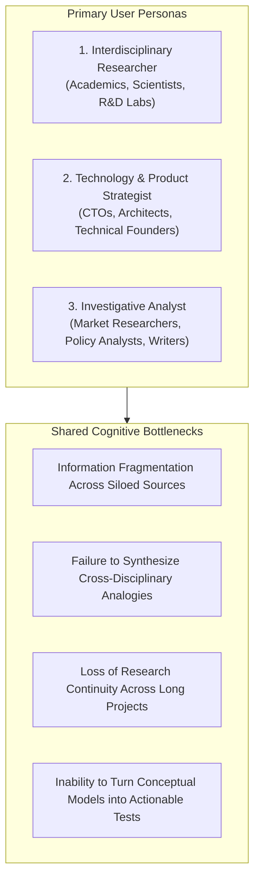
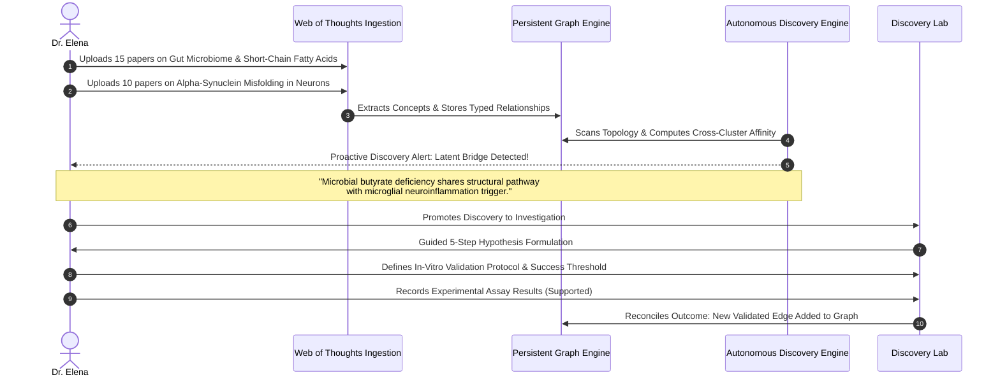

# 03. User Research and Use Cases

## 1. Target User Personas

To ensure Web of Thoughts solves concrete, high-friction problems rather than abstract ideals, we have defined three primary user archetypes based on field studies of knowledge workers, researchers, and systems architects.

---

### Persona 1: Dr. Elena Rostova – The Interdisciplinary Academic Researcher
* **Role & Background:** Associate Professor in Computational Systems Biology; publishes across immunology, gut microbiology, and neurological disorders.
* **Current Tool Stack:** Zotero (15,000 papers), Obsidian (notes), Google Docs (drafting), Python/R (data analysis).
* **Core Pain Points:**
  * Suffers from the "Collector's Fallacy": thousands of PDFs ingested into reference managers that never cross-pollinate.
  * Research literature in immunology uses completely different terminology and journals from neurobiology, making algorithmic keyword search useless for finding common mechanistic pathways.
  * Obsidian's graph view is an unusable circular cloud of 8,000 dots that provides no analytical value.
* **What Elena Needs:** An autonomous system that maps biomedical concepts across distinct paper collections, flags unstated structural similarities (e.g., similar receptor pathways described under different acronyms), and drafts testable laboratory hypotheses.

---

### Persona 2: Marcus Vance – The Frontier Technology Architect & Strategist
* **Role & Background:** Chief Technology Architect at a Series B infrastructure startup; evaluates distributed consensus, hardware acceleration, and decentralized protocols.
* **Current Tool Stack:** Notion (team specs), Heptabase (spatial system diagrams), Claude / ChatGPT (technical brainstorming), GitHub Issues.
* **Core Pain Points:**
  * Brainstorming sessions in LLMs produce brilliant architectural comparisons, but once the chat tab is closed, the insight is lost and never links to existing system documentation.
  * Hard to track architectural trade-offs over time. When a new consensus algorithm paper appears, Marcus cannot easily see which existing architectural assumptions it invalidates.
* **What Marcus Needs:** A persistent architectural graph where proposed trade-offs are stored as first-class relationships, where conflicts between new research and existing design decisions are automatically highlighted, and where architectural spikes (experiments) can be recorded and tracked to completion.

---

### Persona 3: Sarah Lin – The Investigative Market & Policy Analyst
* **Role & Background:** Senior Intelligence Analyst at an energy and geopolitical risk consultancy; publishes deep-dive briefing memos on clean-tech supply chains, critical minerals, and regulatory bottlenecks.
* **Current Tool Stack:** NotebookLM (reading regulatory filings), Feedly (news feeds), Roam Research (historical notes), PowerPoint (deliverables).
* **Core Pain Points:**
  * NotebookLM is superb for reading 20 SEC filings on battery manufacturers, but the insights remain trapped in that single notebook. Sarah cannot link insights across a 3-year timeline of mining policy in South America and battery chemistry developments in East Asia.
  * High risk of hallucinated citations in standard AI tools. Every single claim in her briefing memos must be backed by a verifiable source excerpt to preserve client credibility.
* **What Sarah Needs:** A persistent knowledge canvas that ingests regulatory filings and research reports, preserves exact claim-to-source provenance, detects contradictions between corporate claims and supply chain realities, and guides structured verification.

---

## 2. Real-World User Friction Points in Existing Workflows

Through comprehensive competitive and ethnographic research, we have identified four fundamental breakdown moments in knowledge workflows:

### Friction 1: The "Collector's Fallacy" and Note Graveyards
Users spend hundreds of hours capturing articles, PDFs, and bookmarks into tools like Notion, Pocket, or Obsidian. However, because making connections requires active manual effort, notes become write-only archives. **90% of captured information is never revisited or connected.**

### Friction 2: The "Hairball Graph" Fatigue
Visual graphs in Obsidian, Roam, and Logseq look stunning in marketing screenshots, but quickly become unmanageable "hairballs" once a user has more than 500 notes. Users report: *"The graph view is visually pleasing for five minutes, but completely useless for actual work. It tells me that everything is connected to everything else, which means it tells me nothing."*

### Friction 3: The "Chat Session Amnesia" Barrier
When interacting with ChatGPT, Claude, or Perplexity, the AI performs synthesis within a stateless session. Users experience a constant sense of ephemeral waste: brilliant insights generated in chat vanish into history logs. The AI does not remember what the user discovered two weeks ago unless manually pasted back into the prompt.

### Friction 4: The "Speculation-without-Execution" Trap
Ideas generated in PKM tools or AI chats remain pure speculation. Users have dozens of "interesting hypotheses" recorded in bullet points, but zero structured frameworks to define falsification criteria, design minimum validation tests, or record results. As a result, ideas stagnate and never produce concrete outcomes.

---

## 3. Concrete Cross-Domain Use Cases

### Use Case 1: Interdisciplinary Biomedical Research
**Scenario:** Dr. Elena investigates potential environmental triggers for Parkinson's disease.

* **Outcome:** Rather than reading 25 papers in isolation, Elena receives a high-confidence, non-obvious cross-domain hypothesis linking gut microbial metabolite dysbiosis to neurodegenerative protein aggregates, complete with source citations from both paper clusters and an executable validation protocol.

---

### Use Case 2: Distributed Systems Architecture Spike
**Scenario:** Marcus evaluates the transition of a monolithic event-streaming platform to a serverless edge architecture.

1. **Capture:** Marcus uploads architecture RFCs, benchmark whitepapers on WASM runtimes, and incident post-mortems from the past year.
2. **Concept Extraction:** The system identifies key architectural nodes: `Tail Latency P99`, `Cold Start Penalties`, `Connection Pooling to RDBMS`, `Edge WASM Isolation`.
3. **Autonomous Discovery:** The Discovery Engine highlights a **Contradiction / Conflict Candidate**:
   * *Paper A* asserts that Edge WASM eliminates cold starts (<5ms).
   * *Incident Post-Mortem 2025-11* demonstrates that database connection pooling over edge proxies introduces a 180ms handshake bottleneck.
   * *Discovery Alert:* Proposed architectural migration may degrade P99 latency despite faster runtime execution.
4. **Discovery Lab Execution:** Marcus promotes this conflict into the Discovery Lab:
   * *Hypothesis:* "Using Edge WASM workers with direct TCP connection to regional database clusters will exceed our 50ms P99 SLA for write queries."
   * *Experiment Plan:* Run a 48-hour k6 load test simulating 5,000 concurrent edge requests against a pooled regional Postgres instance.
   * *Criteria:* P99 latency must stay under 40ms.
5. **Outcome:** The benchmark fails (P99 = 112ms). Marcus records the failure in the Lab. The graph updates: the proposed edge migration edge is marked as `status: rejected` with the benchmark run linked as empirical evidence.

---

### Use Case 3: Clean-Tech Market Intelligence & Regulatory Due Diligence
**Scenario:** Sarah analyzes the feasibility of Sodium-Ion battery commercialization for utility-scale grid storage.

1. **Capture:** Ingests European Union Critical Raw Materials regulations, five sodium-ion patent filings, and market commodity forecasts for lithium carbonate.
2. **Autonomous Discovery:** The engine detects a **Knowledge Gap & Structural Bridge**:
   * While sodium raw materials are abundant and cheap, cathode manufacturing requires hard-carbon anodes derived from specialized bio-pitch precursors currently dominated by two single-source refineries.
   * *Discovery Alert:* Supply chain vulnerability identified: "Raw material cost advantage of Sodium-Ion is partially offset by acute precursor refining concentration."
3. **Investigation & Provenance:** Sarah reviews the evidence explorer. The system quotes the exact patent filing paragraphs and tariff codes backing this assertion.
4. **Synthesis:** Sarah exports an evidence-backed intelligence memo directly into client deliverables, knowing every assertion is anchored to verified source documents.

---

## 4. Jobs-To-Be-Done (JTBD) Framework

| When I am... (Trigger) | I want to... (Action) | So that I can... (Outcome) |
| :--- | :--- | :--- |
| Reading dense, disparate technical or academic papers across multiple disciplines... | have an intelligent engine automatically extract concepts and cross-domain connections... | discover breakthroughs without reading thousands of pages manually. |
| Looking at my sprawling collection of notes and research ideas... | see an uncluttered, hierarchically clustered knowledge canvas with clear relationship types... | understand how my thoughts fit together without drowning in a tangled graph hairball. |
| Brainstorming novel product, scientific, or strategic hypotheses... | receive proactive, surprise discoveries backed by exact source evidence... | test genuinely innovative ideas rather than retreading obvious associations. |
| Convinced that a proposed connection has strategic or scientific merit... | convert that discovery into a structured investigation with measurable validation criteria... | prove or disprove the hypothesis empirically and advance my work with confidence. |
| Updating my knowledge base with new experimental results or contradictory data... | have the system automatically flag invalidated assumptions and update the graph state... | maintain an accurate, self-correcting institutional memory that never becomes obsolete. |
