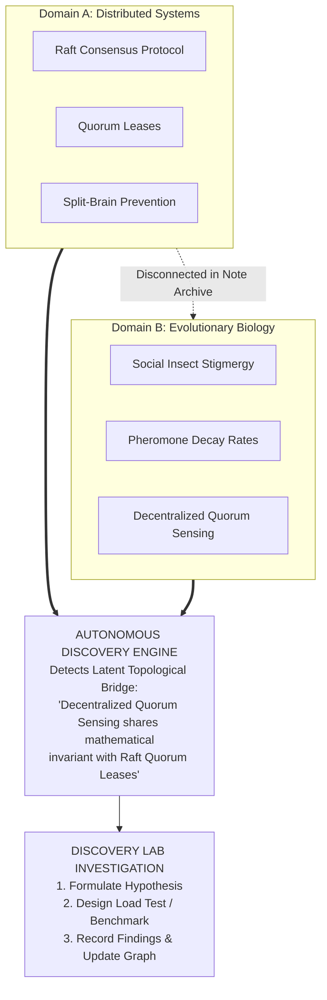
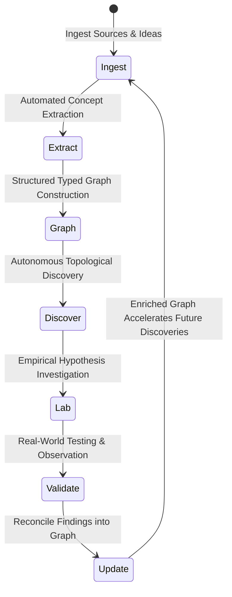

# 04. Product Differentiation and Competitive Moat

## 1. Defining the Core "Aha!" Moment

Every enduring product is defined by a singular, unmistakable moment of realization where the user experiences disproportionate value compared to existing alternatives.

In Web of Thoughts, that "Aha!" moment is **The Serendipitous Bridge Discovery**:

### The Breakdown of the "Aha!" Experience:
1. **The Ingestion:** The user uploads notes from two completely separate domains over the course of weeks (e.g., distributed consensus algorithms and biological quorum sensing). In any other tool (Obsidian, Notion, Apple Notes), these live in different folders and never interact.
2. **The Proactive Alert:** Without the user initiating a prompt, the Autonomous Discovery Engine flags a new card:
   > *"Discovery Candidate: Latent Structural Analogy between Raft Quorum Leases and Honeybee Stigmergy Quorum Sensing. Both mechanisms resolve state inconsistency under packet-loss/communication disruption using localized temporal decay rather than centralized coordination."*
3. **The Evidence Grounding:** The user clicks the card. Instead of vague AI hand-waving, the system displays the two primary source excerpts with exact line citations, showing precisely how the mathematical models correspond.
4. **The Frictionless Action:** The user clicks **"Investigate in Discovery Lab"**. The system immediately sets up an empirical spike: assumptions are extracted, a testable hypothesis is generated, and a concrete benchmark is planned.
5. **The Value Realization:** The user realizes: *"This tool didn't just store my thoughts; it actively synthesized a breakthrough insight I would never have noticed on my own, and gave me the immediate structure to validate it."*

---

## 2. The Knowledge Flywheel & Competitive Moat

Why can't a user achieve this by combining Obsidian, Notion, or ChatGPT? The answer lies in the **Web of Thoughts Knowledge Flywheel**:

### The 4 Pillars of the Defensible Moat:

| Moat Pillar | Mechanism | Why Competitors Cannot Easily Replicate |
| :--- | :--- | :--- |
| **1. Topological Knowledge Graph** | Persistent relational nodes and reified typed edges (`causes`, `contradicts`, `analogous_to`, `supersedes`). | Chatbots have no persistent graph; standard PKM tools have only untyped text links (`[[Wikilinks]]`) that lack semantic compute capability. |
| **2. Compound Discovery Density** | As more concepts are added, the number of potential cross-cluster structural bridges grows quadratically ($O(N^2)$), multiplying discovery opportunities. | A flat document folder or single chat session resets to zero context each time; it does not compound. |
| **3. Grounded Provenance Engine** | Every concept, relationship, and discovery candidate maintains strict bi-directional links to original source chunks and confidence scores. | Generic LLM chats suffer from citation hallucinations; Web of Thoughts enforces deterministic excerpt anchoring. |
| **4. Empirical Feedback Loop** | The Discovery Lab records whether hypotheses were accepted, rejected, or revised, feeding human feedback back into the discovery ranking algorithms. | Tools like Notion or NotebookLM are passive dead ends; they do not learn which types of connections the user finds empirically useful. |

---

## 3. Defense Against Frontier Model Commoditization (The "Why Not Just ChatGPT-5?" Test)

A major risk in any AI software proposal is being rendered obsolete by the next major foundation model release. Below is our formal engineering analysis of why foundation model advancements strengthen rather than threaten Web of Thoughts:

### Failure Mode 1: Context Window Economics and Latency
* **The Chatbot Approach:** To find connections across a user's entire repository of 5,000 notes (approx. 5,000,000 tokens), an LLM chat tool would need to pass all 5M tokens into the context window for every discovery query.
* **Economic Reality:** At current enterprise LLM rates, a single comprehensive cross-scan would cost between **$10.00 and $30.00 per scan** and take 45–90 seconds to process.
* **The Web of Thoughts Approach:** We compute topological community detection, betweenness centrality, and vector similarity locally in the database (PostgreSQL + pgvector). This reduces the candidate space from 5,000,000 tokens down to 2 candidate clusters (approx. 2,000 tokens), executing in **milliseconds for less than $0.001**.
* *Advancement in LLMs only makes our final reasoning tier faster and cheaper, while our graph topology remains the essential filtering foundation.*

### Failure Mode 2: The Hallucination of Relational Truth
* **The Chatbot Approach:** When asked "What connects Concept A and Concept B?", a standard LLM will always produce a plausible-sounding story, even if the connection is completely fabricated, misleading, or trivial.
* **The Web of Thoughts Approach:** The system separates **Deterministic Graph Topology** (what the user actually wrote or ingested) from **Generative Hypothesis** (what the model suggests). Speculative relationships are strictly quarantined with `status: proposed` until validated. The system displays contradiction warnings if new evidence conflicts with an existing node.

### Failure Mode 3: Ephemeral Output vs. Institutional Asset
* **The Chatbot Approach:** The output of a chat conversation is a wall of text in a scrolling chat panel. It cannot be queried via SQL, cannot be visualized in 2D space, cannot be updated when underlying assumptions change, and cannot be integrated into team workflows.
* **The Web of Thoughts Approach:** Every discovery becomes an interactive entity in a relational database. It has an owner, timestamps, confidence scores, validation checklists, and linked evidence records. The user is building a **durable intellectual asset** that increases in enterprise value every day.

---

## 4. Positioning Summary

| Dimension | Generic AI Chatbot | Conventional PKM (Obsidian/Notion) | Web of Thoughts (Path C) |
| :--- | :--- | :--- | :--- |
| **User Role** | Question Asker | Manual Scribe & Organizer | **Research Director / Principal Investigator** |
| **System Role** | Reactive Text Generator | Passive File Cabinet | **Proactive Research Partner & Discovery Engine** |
| **Data Structure** | Ephemeral Conversation | Flat Documents / Untyped Links | **Persistent, Typed, Multi-Layer Knowledge Graph** |
| **Discovery Mode** | On-demand prompt matching | None (Manual browsing) | **Autonomous Topological & Cross-Domain Detection** |
| **Actionability** | Unstructured chat recommendations | Static markdown checklists | **Structured Discovery Lab with Empirical Spikes** |
| **Evolution** | None (Static context window) | Manual document edits | **Dialectical Knowledge Updating & Invalidation** |
