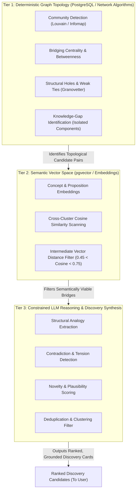
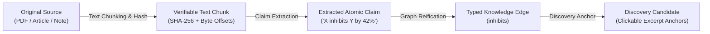
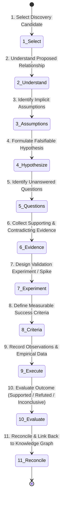

# 06. AI and Autonomous Discovery Engine

## 1. The Autonomous Discovery Engine Architecture

A foundational finding of this research is that **prompting an LLM with a massive dump of notes does not produce reliable scientific or strategic discoveries.** 

When presented with large, unstructured context, language models suffer from:
1. **The "Attention Sinks / Lost-in-the-Middle" Phenomenon:** Key nuances buried between disparate notes are overlooked.
2. **The "Triviality Bias":** The model latches onto the most superficial semantic commonalities (e.g., both notes mention "computers" or "energy") rather than deep structural isomorphisms.
3. **The "Plausibility Trap":** The model invents eloquent explanations for non-existent or logically absurd connections.

To overcome this, Web of Thoughts implements a **3-Tier Hybrid Discovery Pipeline**:

---

## 2. Algorithmic Breakdown of Discovery Tiers

### 2.1 Tier 1: Deterministic Graph Topology
Before invoking an LLM, the system computes graph network metrics directly over the persistent database:
* **Community Detection:** Nodes are partitioned into thematic clusters (using modularity optimization).
* **Structural Holes & Bridging Nodes:** The algorithm searches for pairs of nodes $(u, v)$ that belong to separate clusters $C_A$ and $C_B$ with zero direct edges between them, but possessing structural symmetry or high betweenness centrality in their respective clusters.
* **Weak Ties:** Identifies existing edges with low local clustering coefficients (bridges between distinct components) that have not been investigated.
* **Knowledge Gaps:** Flags high-degree concepts with zero outbound cross-cluster connections (isolated knowledge silos).

### 2.2 Tier 2: Vector Space Distance Filtering
Pure topological pairing can yield thousands of random combinations. Tier 2 applies embedding mathematics:
* **The "Goldilocks Semantic Zone":**
  * If $\text{Cosine Similarity}(u, v) > 0.85$: The concepts are semantically near-identical (e.g., "Deep Learning" and "Neural Networks"). This produces **trivial, obvious connections** that annoy the user.
  * If $\text{Cosine Similarity}(u, v) < 0.35$: The concepts are completely unrelated noise (e.g., "17th Century Poetry" and "Kubernetes Ingress Controllers").
  * **The Target Zone ($0.45 \le \text{Cosine Similarity} \le 0.75$):** This interval captures concepts with enough conceptual distance to be novel, but enough latent structural affinity to represent genuine cross-domain analogies or actionable contradictions.

### 2.3 Tier 3: Constrained LLM Synthesis & Scoring
The top $K$ candidate pairs $(u, v)$ passing Tiers 1 and 2 are formatted into a structured prompt containing only the verified concepts, their immediate neighbor assertions, and exact source excerpts.

The model evaluates four discovery dimensions:
1. **Analogy / Structural Isomorphism:** Do these concepts share an underlying mathematical, organizational, or causal mechanism despite different domain jargon?
2. **Contradiction / Empirical Tension:** Does Source A make a claim that directly invalidates or limits a claim made in Source B?
3. **Plausibility Score ($0.0 - 1.0$):** Is the proposed relationship physically, mathematically, or logically defensible?
4. **Novelty Score ($0.0 - 1.0$):** Has this relationship been explicitly stated in the user's notes before, or is it an unstated synthesis?

### 2.4 Discovery Ranking Function
Discovery candidates are ranked for the user interface using a deterministic composite score:

$$\text{Score}_{\text{Discovery}} = w_1 \cdot \text{Novelty} + w_2 \cdot \text{Plausibility} + w_3 \cdot \text{TopologicalBridging} + w_4 \cdot \text{SourceGrounding} - w_5 \cdot \text{UserDismissalPenalty}$$

Where default weights are: $w_1 = 0.25, w_2 = 0.25, w_3 = 0.20, w_4 = 0.20, w_5 = 0.30$.

---

## 3. Evidence Explorer and Citation Verification

A core design requirement is eliminating AI hallucinations. The **Evidence Explorer** enforces complete provenance:

### Provenance Rules:
1. **Deterministic Byte Anchors:** When a claim is extracted, the database records `source_id`, `chunk_index`, `start_offset`, and `end_offset`. In the UI, clicking a citation instantly highlights the exact verbatim excerpt in the source document.
2. **Confidence and Uncertainty Tagging:** Every extracted edge and proposed discovery includes an explicit confidence tier:
   * **Tier 1 (Deterministic/Verbatim):** Direct quote or explicit user entry ($\ge 0.95$).
   * **Tier 2 (Extracted Inference):** High-confidence semantic relationship derived from text ($0.75 - 0.94$).
   * **Tier 3 (Speculative Proposal):** Discovery Engine cross-domain hypothesis ($0.50 - 0.74$).
   * *Below 0.50 candidates are automatically discarded.*
3. **Contradiction Flagging:** If a new ingested source contains a claim that negates an existing edge, the system creates a `status: disputed` edge and alerts the user rather than silently overwriting the prior claim.

---

## 4. The Discovery Lab: 11-Step Investigation Workflow

When a user selects a promising discovery candidate, they promote it to the **Discovery Lab**. The Lab guides the user through an empirical, 11-step structured investigation:

### Step-by-Step Lab Protocol:
1. **Select Discovery:** The user inspects candidate cards and chooses one to investigate.
2. **Understand Relationship:** The system presents the structural analogy or tension with side-by-side evidence chunks.
3. **Identify Assumptions:** The AI assists in decomposing the hidden premises required for this connection to be true.
4. **Formulate Falsifiable Hypothesis:** Converts vague ideas into a formal testable assertion (e.g., *"If X is introduced into Environment Y, then Metric Z will decrease by at least N% because of Mechanism M"*).
5. **Identify Unanswered Questions:** Highlights specific knowledge gaps that cannot be resolved with currently available sources.
6. **Collect Evidence:** The user queries internal notes or external literature via Firecrawl to gather supporting and contradicting citations.
7. **Generate Experiment / Validation Plan:** Formulates a concrete action plan (e.g., code benchmark, laboratory assay protocol, customer survey, or targeted literature review).
8. **Define Measurable Success Criteria:** Establishes unambiguous numeric or qualitative thresholds for success vs. falsification.
9. **Record Observations:** The user documents real-world logs, data points, and qualitative notes during execution.
10. **Evaluate Outcome:** Categorizes the investigation into one of three definitive states: `Supported`, `Refuted`, or `Inconclusive`.
11. **Reconcile with Knowledge Graph:**
    * If `Supported`: The relationship is elevated to `status: accepted` and permanently written into the canonical knowledge graph as an established bridge.
    * If `Refuted`: The relationship is marked `status: rejected` with the experiment linked as negative proof, preventing the Discovery Engine from re-proposing this false lead in the future.
    * If `Inconclusive`: The hypothesis remains active with notes for future follow-up.

---

## 5. Knowledge Evolution and Temporal Revisions

Real knowledge is not static; it evolves as new facts emerge and old assumptions are disproven.

### The Temporal Evolution Model:
* **Edge Lifecycle States:**
  * `proposed`: Created by AI Discovery Engine; unverified.
  * `accepted`: Validated by user or confirmed via Discovery Lab experiment.
  * `rejected`: Tested and disproven; retained in history to prevent duplicate suggestions.
  * `disputed`: Conflicted by two or more credible sources with opposing claims.
  * `superseded`: Replaced by a more refined, higher-order concept or newer scientific version.
* **Append-Only Knowledge Log (`knowledge_revisions`):** Rather than performing destructive SQL `UPDATE` operations on nodes and edges, changes generate historical revision records.
* **Timeline Slider:** The UI provides a temporal slider allowing users to inspect what their knowledge graph looked like at any point in the past, visualizing how ideas emerged, consolidated, or fell out of favor over time.
