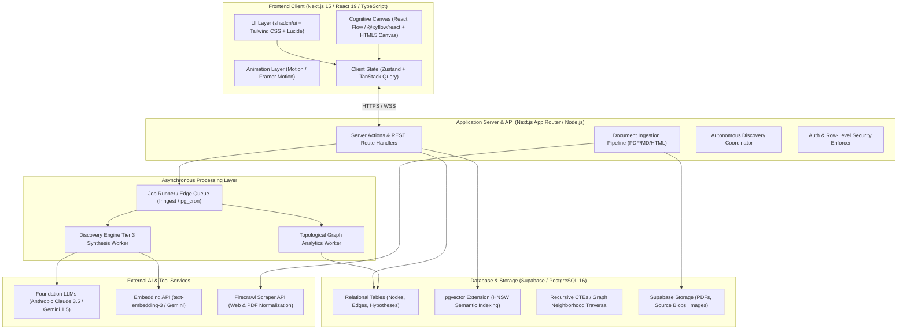
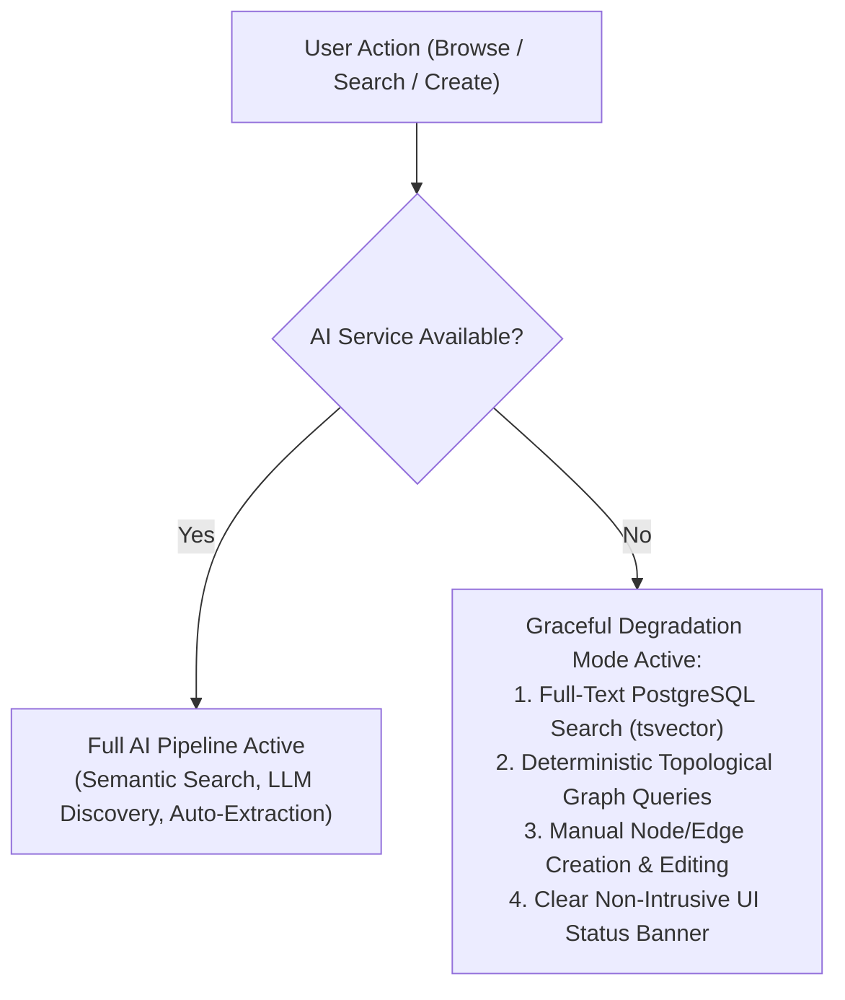

# 07. Technical Architecture and Stack Evaluation

## 1. System Architecture Overview

Web of Thoughts is architected as an **intelligent, data-dense client-server application** optimized for high-performance interactive graph visualization, deterministic relational persistence, and asynchronous AI discovery pipelines.

---

## 2. Frontend Stack & Graph Visualization Evaluation

### 2.1 Graph Rendering Engine Selection
The choice of graph visualization library is critical to avoid the "sluggish hairball" problem while supporting rich custom UI nodes. We evaluated five candidate rendering architectures:

| Engine | Rendering Tech | Max Nodes / Performance | Custom HTML/React Nodes | Interaction Flexibility | Recommendation |
| :--- | :--- | :---: | :---: | :---: | :---: |
| **React Flow (`@xyflow/react`)** | DOM + SVG / Canvas Hybrid | ~1,000 nodes | **Exceptional** (Full React component rendering inside nodes) | World-class zoom, pan, drag, custom handles, minimap | **RECOMMENDED PRIMARY CANVAS** |
| **Sigma.js / Graphology** | WebGL | 100,000+ nodes | Poor (Canvas/WebGL textures only) | Fast pan/zoom, but custom interactive card layouts are difficult | Optional for giant global graph overview |
| **Cytoscape.js** | HTML5 Canvas | ~5,000 nodes | Moderate (Requires canvas overlay plugins) | Rich algorithmic graph layout algorithms (Cose, Dagre) | **RECOMMENDED LAYOUT HELPER** |
| **Force-Graph (2D)** | HTML5 Canvas | ~10,000 nodes | Limited (Canvas drawing context) | Smooth physics, but weak interactive card support | Good alternative |
| **Three.js / 3D-Force-Graph** | WebGL 3D | ~10,000 nodes | Very Difficult (3D CSS transforms) | Disorienting UX; 3D graph navigation causes user nausea | **NOT RECOMMENDED** (Fails usability principles) |

### Final Graph Engine Decision:
* **Primary Interactive Canvas:** **`@xyflow/react` (React Flow v12)**. 
  * *Rationale:* The Discovery Lab and Knowledge Canvas require rich interactive node cards with buttons, tags, status badges, progress bars, and citation previews. React Flow allows every node to be a first-class React component with complete accessibility, keyboard navigation, and micro-interactions.
* **Layout Computation:** **`graphology` + `layout-forceatlas2` / `dagre`** running in a Web Worker to calculate non-overlapping node coordinates asynchronously without blocking the main UI thread.

### 2.2 Core Frontend Stack
* **Framework:** Next.js 15 (App Router with React 19 Server Components for fast initial data fetching and Client Components for the interactive canvas).
* **Language:** TypeScript 5.5+ (Strict mode, zero `any` policy).
* **Styling & Design Tokens:** Tailwind CSS v4 + `shadcn/ui` (accessible Radix UI primitives).
* **Animation & Micro-interactions:** `framer-motion` / `motion` for polished panel transitions, discovery card drawer expansions, and evidence popovers.
* **Client State Management:** `zustand` for high-performance canvas viewport and selection state; `tanstack/react-query` for server synchronization and optimistic cache updates.

---

## 3. Backend, Database, and Storage Architecture

### 3.1 Persistence Layer: PostgreSQL 16 via Supabase
Rather than using a specialized NoSQL graph database (like Neo4j) which introduces high operational overhead and disconnects relational metadata from vector data, we standardize on **PostgreSQL 16 with extensions**:

1. **Relational Graph Queries:** Directed graph traversal, multi-hop pathfinding, and cycle detection are handled natively using **Recursive Common Table Expressions (CTEs)** and indexed foreign keys.
2. **Vector Semantic Search (`pgvector`):** High-dimensional concept embeddings (1536d or 768d) are indexed using **HNSW (Hierarchical Navigable Small World)** indexes, providing sub-millisecond approximate nearest neighbor search directly alongside relational filters.
3. **Multi-Tenant Row-Level Security (RLS):** Every query enforces `auth.uid() = user_id` at the database engine level, guaranteeing cryptographically enforced tenant isolation.
4. **Object Storage:** Supabase Storage (S3-compatible) for raw PDF documents, research whitepapers, and exported visual snapshots.

### 3.2 Asynchronous Job & Discovery Pipeline
Autonomous discovery is computationally intensive and must not block user requests.
* **Task Scheduling:** Managed via **pg_cron** or **Inngest**.
* **Execution Trigger:**
  * **Event-Driven:** Ingestion of new documents triggers an incremental extraction and topological bridge scan for the affected sub-graph.
  * **Scheduled Maintenance:** Nightly background scan evaluates global betweenness centrality, re-clusters communities, and prunes obsolete discovery candidates.

---

## 4. AI & Retrieval Pipeline

### 4.1 Embedding Generation
* **Production Default:** `text-embedding-3-small` (1536 dimensions) or Google's `text-embedding-004` (768 dimensions) for superior semantic retrieval fidelity and low cost.
* **Local/Zero-Cost Option:** `@xenova/transformers` (running `bge-small-en-v1.5` in browser ONNX runtime) for offline or privacy-sensitive local search.

### 4.2 Foundation LLMs for Reasoning
* **Extraction & Tier 3 Discovery:** Structured JSON generation using **Anthropic Claude 3.5 Sonnet** or **Google Gemini 1.5 Pro**. Both models demonstrate elite capabilities in formal logical reasoning, structured tool calling, and source-grounded claim extraction.
* **Low-Latency Interactive Assistance:** **Gemini 1.5 Flash** or **Claude 3.5 Haiku** for inline editor completions and interactive chat within the Discovery Lab.

### 4.3 Resilience & Graceful Offline Degradation
The system is explicitly engineered to remain functional even during complete external AI provider outages:

* **No Data Loss:** All graph manipulation, manual linking, and Discovery Lab note-taking work offline or without LLM keys.
* **Deterministic Fallback:** Lexical search uses Postgres `tsvector` with English stemming; graph traversals run via SQL CTEs.
