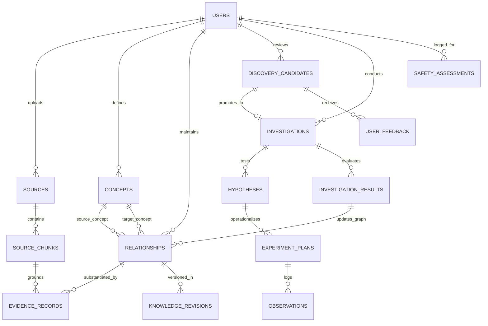

# 08. Data Model and Provenance System

## 1. Relational Schema Architecture & Design Principles

The Web of Thoughts database schema is designed around four foundational data engineering principles:

1. **Reified Relationships as First-Class Entities:** Edges are not simple foreign keys or string tags; they are first-class database records with their own IDs, semantic types, directional properties, confidence scores, lifecycle states, and source provenance links.
2. **Strict Provenance & Verifiable Grounding:** Every extracted concept and relationship points back to an exact `source_chunk` with character offsets. No assertion exists without an audit trail.
3. **Temporal Non-Destructive Knowledge Revision:** Updating or disputing a relationship creates a versioned revision entry rather than an untraceable in-place overwrite.
4. **Relational Multi-Tenant Isolation:** Every table includes a `user_id` foreign key bound to `auth.users`, strictly governed by PostgreSQL Row-Level Security (RLS) policies.

---

## 2. Complete Entity-Relationship Diagram (ERD)



> [!NOTE]
> The original requirements mentioned "Ideas" and "Collections" as organizational concepts. In the MVP schema, raw user input is captured as **Sources** (the ingestion record containing the text). Concepts are extracted *from* Sources. A future "Collections" feature for manual grouping is deferred to Scope B. The `SUCCESS_CRITERIA` entity is modeled as a JSONB array field within `experiment_plans` to reduce join complexity in the MVP.

---

## 3. Detailed Entity Specifications

### 3.1 Core Knowledge & Concept Tables

#### `users`
* **Purpose:** Multi-tenant user account representation linked to Supabase Auth.
* **Key Fields:** `id` (UUID, PK), `email` (TEXT, UNIQUE), `created_at` (TIMESTAMPTZ), `tier` (TEXT).
* **Constraints:** Managed via Supabase Auth schema.

#### `sources`
* **Purpose:** Stores uploaded documents, web URLs, or reference materials.
* **Key Fields:** `id` (UUID, PK), `user_id` (UUID, FK), `title` (TEXT), `source_type` (TEXT: `pdf`, `url`, `markdown`, `manual`), `uri` (TEXT), `file_hash` (TEXT, SHA-256), `metadata` (JSONB), `created_at` (TIMESTAMPTZ).
* **Indexing:** B-Tree on `(user_id, created_at)`, B-Tree on `(user_id, file_hash)`.

#### `source_chunks`
* **Purpose:** Fine-grained, token-bounded text chunks used for vector retrieval and citation anchoring.
* **Key Fields:** `id` (UUID, PK), `source_id` (UUID, FK), `user_id` (UUID, FK), `chunk_index` (INT), `content` (TEXT), `start_char` (INT), `end_char` (INT), `embedding` (VECTOR(1536)), `created_at` (TIMESTAMPTZ).
* **Indexing:** HNSW index on `embedding` using cosine distance; B-Tree on `(source_id, chunk_index)`.

#### `concepts`
* **Purpose:** Normalized conceptual nodes in the knowledge graph.
* **Key Fields:** 
  * `id` (UUID, PK)
  * `user_id` (UUID, FK)
  * `canonical_name` (TEXT)
  * `aliases` (TEXT[])
  * `description` (TEXT)
  * `domain_category` (TEXT)
  * `embedding` (VECTOR(1536))
  * `color` (TEXT)
  * `created_at` (TIMESTAMPTZ), `updated_at` (TIMESTAMPTZ)
* **Constraints:** `UNIQUE(user_id, LOWER(canonical_name))`.
* **Indexing:** HNSW on `embedding`, B-Tree on `(user_id, domain_category)`.

#### `relationships` (Reified Knowledge Edges)
* **Purpose:** Typed semantic connections between concepts with full lifecycle and confidence scoring.
* **Key Fields:**
  * `id` (UUID, PK)
  * `user_id` (UUID, FK)
  * `source_concept_id` (UUID, FK to concepts)
  * `target_concept_id` (UUID, FK to concepts)
  * `relationship_type` (TEXT: `causes`, `contradicts`, `analogous_to`, `enables`, `depends_on`, `inhibits`, `is_a`, `associated_with`)
  * `directional` (BOOLEAN, default TRUE)
  * `confidence_score` (NUMERIC(3,2), range 0.00 to 1.00)
  * `status` (TEXT: `proposed`, `accepted`, `rejected`, `disputed`, `superseded`)
  * `rationale` (TEXT)
  * `created_at` (TIMESTAMPTZ), `updated_at` (TIMESTAMPTZ)
* **Constraints:** Check constraint `source_concept_id != target_concept_id`.
* **Indexing:** B-Tree on `(user_id, source_concept_id, target_concept_id)`, B-Tree on `(user_id, status)`.

#### `evidence_records`
* **Purpose:** Grounding links that bind relationships or hypotheses to verifiable source chunks.
* **Key Fields:**
  * `id` (UUID, PK)
  * `user_id` (UUID, FK)
  * `relationship_id` (UUID, FK to relationships, NULLABLE)
  * `hypothesis_id` (UUID, FK to hypotheses, NULLABLE)
  * `source_chunk_id` (UUID, FK to source_chunks)
  * `claim_text` (TEXT)
  * `verbatim_quote` (TEXT)
  * `stance` (TEXT: `supports`, `refutes`, `neutral`)
  * `created_at` (TIMESTAMPTZ)
* **Indexing:** B-Tree on `(relationship_id)`, B-Tree on `(hypothesis_id)`.

---

### 3.2 Autonomous Discovery & Investigation (Lab) Tables

#### `discovery_candidates`
* **Purpose:** Proactively generated discovery suggestions from the 3-Tier engine.
* **Key Fields:**
  * `id` (UUID, PK)
  * `user_id` (UUID, FK)
  * `concept_a_id` (UUID, FK to concepts)
  * `concept_b_id` (UUID, FK to concepts)
  * `discovery_type` (TEXT: `cross_domain_analogy`, `structural_hole_bridge`, `latent_contradiction`, `knowledge_gap`)
  * `proposed_relationship` (TEXT)
  * `explanation` (TEXT)
  * `novelty_score` (NUMERIC(3,2))
  * `plausibility_score` (NUMERIC(3,2))
  * `composite_score` (NUMERIC(3,2))
  * `status` (TEXT: `unread`, `pinned`, `investigating`, `dismissed`)
  * `created_at` (TIMESTAMPTZ)
* **Indexing:** B-Tree on `(user_id, status, composite_score DESC)`.

#### `investigations`
* **Purpose:** Container for an active inquiry launched in the Discovery Lab.
* **Key Fields:**
  * `id` (UUID, PK)
  * `user_id` (UUID, FK)
  * `discovery_id` (UUID, FK to discovery_candidates, NULLABLE)
  * `title` (TEXT)
  * `summary` (TEXT)
  * `stage` (TEXT: `hypothesis`, `design`, `execution`, `evaluation`, `completed`)
  * `created_at` (TIMESTAMPTZ), `updated_at` (TIMESTAMPTZ)
* **Indexing:** B-Tree on `(user_id, stage)`.

#### `hypotheses`
* **Purpose:** Falsifiable scientific or strategic claims formulated during an investigation.
* **Key Fields:**
  * `id` (UUID, PK)
  * `investigation_id` (UUID, FK)
  * `user_id` (UUID, FK)
  * `statement` (TEXT)
  * `assumptions` (TEXT[])
  * `independent_variables` (TEXT[])
  * `dependent_variables` (TEXT[])
  * `status` (TEXT: `draft`, `active`, `validated`, `falsified`, `inconclusive`)
  * `created_at` (TIMESTAMPTZ)

#### `experiment_plans`, `success_criteria` (inline), & `observations`
* **Purpose:** Practical validation protocols designed to test a hypothesis. Success criteria are stored as a JSONB array within `experiment_plans` to minimize join overhead in the MVP.
* **Key Fields (`experiment_plans`):** `id` (UUID, PK), `hypothesis_id` (UUID, FK), `title` (TEXT), `methodology` (TEXT), `success_criteria` (JSONB array of `{metric_name, target_threshold, operator}`), `observations` (TEXT), `outcome` (TEXT: `supported`, `refuted`, `inconclusive`), `status` (TEXT: `planned`, `running`, `completed`), `created_at` (TIMESTAMPTZ), `completed_at` (TIMESTAMPTZ).

> [!NOTE]
> The `success_criteria` and `observations` entities from the original data model specification are consolidated into the `experiment_plans` table as JSONB and TEXT fields respectively. This simplifies the MVP schema while preserving all required data. Separate `success_criteria` and `observations` tables can be introduced in Scope B if querying individual criteria independently becomes a requirement.

#### `user_feedback`
* **Purpose:** Tracks human decisions on discovery candidates to dynamically calibrate ranking weights.
* **Key Fields:** `id` (UUID, PK), `discovery_id` (UUID, FK), `user_id` (UUID, FK), `action` (TEXT: `accept`, `dismiss`, `pin`, `flag_misleading`), `feedback_reason` (TEXT), `created_at` (TIMESTAMPTZ).

#### `knowledge_revisions`
* **Purpose:** Append-only audit log tracking every mutation, supersession, or invalidation of nodes and edges.
* **Key Fields:** `id` (UUID, PK), `user_id` (UUID, FK), `entity_type` (TEXT: `concept`, `relationship`), `entity_id` (UUID), `previous_state` (JSONB), `new_state` (JSONB), `reason` (TEXT), `timestamp` (TIMESTAMPTZ).

#### `safety_assessments`
* **Purpose:** Privacy-conscious audit log tracking policy evaluations, permitted scopes, and safe redirections across operations.
* **Key Fields:**
  * `id` (UUID, PK)
  * `user_id` (UUID, FK)
  * `target_entity_type` (TEXT: `source`, `concept`, `discovery`, `investigation`, `experiment`)
  * `target_entity_id` (UUID)
  * `policy_version` (TEXT, e.g. `'v1.0'`)
  * `decision` (TEXT: `ALLOW`, `ALLOW_WITH_LIMITS`, `CLARIFY`, `REFUSE_AND_REDIRECT`, `BLOCK_SPECIFIC_OPERATION`)
  * `category` (TEXT: `benign`, `cybersecurity_defensive`, `cybersecurity_offensive`, `cbrn`, `harmful_action`, `dual_use_research`, `ambiguous`)
  * `rationale_summary` (TEXT)
  * `permitted_scope` (TEXT)
  * `assessment_method` (TEXT: `deterministic_rule`, `llm_classifier`, `fallback_default`)
  * `created_at` (TIMESTAMPTZ)
* **Indexing:** B-Tree on `(user_id, target_entity_type, target_entity_id)`.

---

## 4. Row-Level Security (RLS) Strategy

Every table implements strict RLS to ensure complete data isolation:
```sql
-- Standard RLS pattern applied to all Web of Thoughts tables
ALTER TABLE relationships ENABLE ROW LEVEL SECURITY;

CREATE POLICY "Users can only view their own relationships"
ON relationships FOR SELECT
USING (auth.uid() = user_id);

CREATE POLICY "Users can only mutate their own relationships"
ON relationships FOR ALL
USING (auth.uid() = user_id)
WITH CHECK (auth.uid() = user_id);
```
