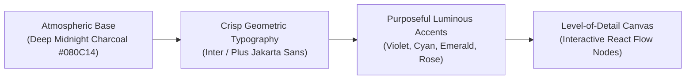

# 09. Design System and Experience Specification

## 1. Visual Identity & Aesthetic Principles: "The Cognitive Observatory"

Web of Thoughts rejects the visual clichés of both utilitarian corporate dashboards and over-the-top, disorienting 3D "cyberpunk" interfaces. The product is designed around the visual metaphor of a **Cognitive Observatory**: an environment of deep visual calm, scientific precision, luminous clarity, and high intellectual focus.



### Core Design Principles:
1. **Depth Without Distraction:** Deep charcoal and slate surfaces provide visual depth through subtle borders (`rgba(255, 255, 255, 0.08)`) and ambient backdrop blurs, eliminating stark, harsh contrasts.
2. **Color is Information, Not Decoration:** Luminous accent colors are reserved strictly for semantic states: violet for discoveries and analogies, cyan for causal connections, emerald for empirically verified facts, amber for assumptions, and rose for contradictions.
3. **Progressive Level-of-Detail (LOD):** The interface exposes complexity gracefully. Distant views emphasize topological clusters; zooming closer reveals node titles; zooming fully in expands rich interactive cards.
4. **Motion with Intentional Physics:** Animations are bounded, high-spring, low-duration micro-interactions designed to convey spatial orientation, not slow down power users.

---

## 2. Design Tokens and Theme Specifications

### 2.1 Color Palette & Semantic Tokens

```
Foundation (Dark Theme Default):
  --bg-cosmic:          #080C14 (Deepest viewport background)
  --surface-ground:     #0D131F (Base application shell)
  --surface-card:       #131B2E (Canvas node cards & modal backdrops)
  --surface-overlay:    #1A243D (Hover states & elevated inspector panels)
  --border-subtle:      rgba(255, 255, 255, 0.07)
  --border-active:      rgba(139, 92, 246, 0.40) (Violet focus ring)

Typography:
  --text-primary:       #F8FAFC (Headings & active node titles)
  --text-secondary:     #94A3B8 (Body text, relationship labels)
  --text-muted:         #64748B (Timestamps, metadata, subtle badges)

Semantic Accents:
  --accent-discovery:   #8B5CF6 (Luminous Violet - Discovery Engine & Analogies)
  --accent-causal:      #06B6D4 (Electric Cyan - Causal & Enabling Relationships)
  --accent-verified:    #10B981 (Emerald Green - Validated Hypotheses & Facts)
  --accent-warning:     #F59E0B (Amber Gold - Unverified Assumptions & Gaps)
  --accent-conflict:    #F43F5E (Vibrant Rose - Contradictions & Disputed Edges)
```

### 2.2 Typography Scale & Font Pairings
* **Primary Sans:** *Inter* or *Plus Jakarta Sans* for exceptional legibility at small sizes inside graph nodes.
* **Technical Monospace:** *JetBrains Mono* for confidence scores, byte offsets, source hashes, and hypothesis metric criteria.
* **Hierarchy:**
  * Canvas Display Node: `text-sm font-semibold tracking-tight`
  * Node Label/Type: `text-xs font-mono uppercase tracking-wider`
  * Discovery Title: `text-base font-semibold leading-snug`
  * Body & Citations: `text-sm font-normal leading-relaxed text-secondary`

---

## 3. The 3-Column Responsive Application Shell

The user workspace is structured into three synchronized spatial panes:

```
+----------------+--------------------------------------+--------------------+
|  EXPLORATION   |         COGNITIVE CANVAS             |     EVIDENCE &     |
|   NAVIGATION   |       & DISCOVERY LAB                |     INSPECTOR      |
|                |                                      |                    |
| [Search Ideas] |  [Node: Raft] ===== [Node: Bees]     | Selected: Bridge   |
| [Graph Filter] |        \              /              |                    |
| [Discoveries 4]|         \            /               | Excerpt Source A:  |
| [Active Labs 2]|      [Discovery: Quorum Sensing]     | "Raft quorums..."  |
|                |                                      |                    |
| [Timeline Sl.] |   +--------------------------------+ | Excerpt Source B:  |
| 2024----2026   |   | Discovery Lab: Step 4 Active   | | "Bee stigmergy..." |
|                |   | "Hypothesis Formulation"       | |                    |
|                |   +--------------------------------+ | [Promote to Lab]   |
| (Width: 260px) |            (Fluid Flex-1)            | (Width: 380px)     |
+----------------+--------------------------------------+--------------------+
```

1. **Left Navigation & Discovery Feed (260px):**
   * Instant full-text/semantic search bar.
   * Quick filters by domain cluster and edge status (`accepted`, `proposed`, `disputed`).
   * Notification badge feed for newly generated Discovery Candidates.
   * Temporal slider to travel back through graph history.
2. **Center Cognitive Canvas / Lab (Fluid):**
   * Pan, zoom, and multi-select React Flow canvas.
   * Toggle between **"Knowledge Universe"** (global graph view) and **"Discovery Lab"** (focused hypothesis workbench).
3. **Right Contextual Inspector & Evidence Panel (380px collapsible):**
   * Deep-dive details on currently selected node, edge, or discovery candidate.
   * Side-by-side verbatim source citations with highlighted byte offsets.
   * Direct actions: "Accept Edge", "Dispute Claim", "Launch Investigation".

---

## 4. Graph Visualization Language & Node Anatomy

### 4.1 Node Anatomy (Inside React Flow)

```
+----------------------------------------------------+
| [o] BIOLOGY CLUSTER                  Score: 0.92   |  <- Category & Confidence
| Honeybee Quorum Stigmergy                          |  <- Canonical Concept Name
| Dynamic decentralized consensus mechanism...       |  <- Concise Claim / Description
|----------------------------------------------------|
| 6 Connections  |  2 Citations  |  [Status: Accepted|  <- Metadata Bar
+----------------------------------------------------+
```

### 4.2 Edge Styling Conventions

| Relationship Type | Stroke Style | Stroke Color | Animated Flow | Marker End |
| :--- | :--- | :--- | :---: | :---: |
| **`causes` / `enables`** | Solid (2px) | `--accent-causal` (`#06B6D4`) | Forward particle | Closed Arrow |
| **`contradicts` / `disputes`** | Dashed (2px) | `--accent-conflict` (`#F43F5E`) | Alternating pulse | Crossbar Marker |
| **`analogous_to` (Discovery)** | Gradient Glow (3px) | `--accent-discovery` (`#8B5CF6`) | Subtle wave | Bidirectional Diamond |
| **`proposed` (AI Unverified)** | Dotted (1.5px) | `--text-muted` (`#64748B`) | None | Open Outline Arrow |

### 4.3 Level-of-Detail (LOD) Semantic Zooming
To prevent visual overload:
* **Zoom Level < 0.4x (Cosmic View):** Node text disappears. Nodes collapse into soft, glowing color-coded density clusters showing macro-topological islands and structural bridges.
* **Zoom Level 0.4x - 0.9x (Structural View):** Canonical concept names and primary edge lines appear. Nodes show minimal pill badges.
* **Zoom Level > 0.9x (Inspection View):** Full node cards render with interactive action buttons, connection counts, and live status badges.

---

## 5. Motion Principles and Accessibility Standards

* **Spring Physics:** Using `framer-motion` transition defaults: `type: "spring", stiffness: 350, damping: 30` for smooth card drawer reveals and tab switching.
* **Graph Auto-Layout Transitions:** When running layout re-arrangements, nodes glide to their target coordinates over 600ms with smooth cubic-bezier easing (`cubic-bezier(0.16, 1, 0.3, 1)`).
* **WCAG 2.1 AA Compliance:**
  * Contrast ratios between text and background exceed 4.5:1.
  * All graph actions (node selection, expansion, lab promotion) are accessible via standard keyboard shortcuts (`Tab`, `Enter`, `Esc`, `Cmd+K` palette).
* **Respects `prefers-reduced-motion`:** In reduced-motion mode, all continuous edge animation pulses, particle simulations, and layout springs are converted into instantaneous zero-duration transitions.
