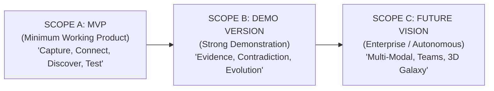

# 11. MVP Scope and Phased Product Roadmap

## 1. Scope Stratification Framework

To deliver a high-quality product without succumbing to feature bloat or premature complexity, Web of Thoughts is divided into three distinct, progressive release tiers:

---

## 2. Scope A: Minimum Working Product (Core MVP)

The objective of Scope A is to deliver a rock-solid, fully verifiable vertical slice containing the entire 8-stage lifecycle. Every feature in Scope A is mandatory for demonstrating core product viability.

| Feature Name | User Value | Complexity | Dependencies | Technical & Delivery Risks | Acceptance Criteria |
| :--- | :--- | :---: | :--- | :--- | :--- |
| **A1: Frictionless Capture** | High: Ingest notes and text quickly. | Low | Supabase Auth, Postgres schema | Input validation bottlenecks. | User can create text notes and paste Markdown; records persist instantly in Postgres. |
| **A2: Concept & Relationship Extraction** | Critical: Automatically populates graph. | Medium | LLM API (Claude/Gemini), Zod schema | LLM JSON parsing failures. | System extracts 3–8 atomic concepts and typed relationships per note with confidence $\ge 0.75$. |
| **A3: Interactive Cognitive Canvas** | High: Visualizes connections. | Medium | React Flow (`@xyflow/react`), Tailwind | UI lag if node count exceeds 500. | Pan, zoom, drag nodes; render directional typed edges with distinct colors; click to inspect node details. |
| **A4: Basic Discovery Engine** | Critical: Surfaces non-obvious links. | Medium | pgvector cosine similarity, Tier 3 LLM prompt | Returning obvious or trivial pairings. | Engine evaluates concept pairs with intermediate vector distance and outputs ranked discovery candidate cards with explanations. |
| **A5: Basic Evidence Anchoring** | High: Verifies claim credibility. | Medium | Text chunking, PostgreSQL text offsets | Offset drift after edits. | Discovery card displays exact verbatim text excerpt from original note justifying the proposed connection. |
| **A6: Discovery Lab (MVP)** | Critical: Turns discoveries into experiments. | Medium | Relational schema (Hypothesis, Plans) | Overly complex multi-step UI. | User clicks "Investigate"; formulates 1 hypothesis; defines 1 validation test + success metric; records outcome (`Supported`/`Refuted`). |
| **A7: Graph Outcome Reconciliation** | High: Evolves the graph. | Medium | SQL mutations on `relationships` | Inconsistent graph state. | Completing an investigation updates relationship status from `proposed` to `accepted` or `rejected`, visibly changing edge style on canvas. |

---

## 3. Scope B: Strong Demonstration Version

Scope B expands the depth, intelligence, and visual polish of the product, making it ready for public demonstration and power-user trials.

| Feature Name | User Value | Complexity | Dependencies | Technical & Delivery Risks | Acceptance Criteria |
| :--- | :--- | :---: | :--- | :--- | :--- |
| **B1: Multi-Format Document Ingestion** | High: Ingest PDFs and Web URLs. | High | Firecrawl API, PDF parsing library | Memory spikes on large PDFs; SSRF risks. | Ingests 50-page PDF and web URLs; cleans Markdown; extracts concepts with page/chunk anchors. |
| **B2: Topological Community Detection** | High: Groups related ideas into visual clusters. | Medium | Graphology, Louvain algorithm | Layout recalculation performance. | Canvas automatically groups nodes into color-coded thematic clusters; computes betweenness centrality. |
| **B3: Contradiction & Tension Detection** | Very High: Flags conflicting research claims. | High | Tier 3 LLM prompt, stance classification | False-positive conflict warnings. | Proactively flags when a newly ingested paper contradicts an existing relationship; sets edge status to `disputed`. |
| **B4: Discovery History & Feedback** | Medium: Improves engine relevance. | Low | `user_feedback` table | Feedback sparsity. | User can dismiss or pin discoveries; engine incorporates dismissal penalties into future rankings. |
| **B5: Knowledge Timeline & Evolution** | High: Tracks how thoughts change over time. | Medium | `knowledge_revisions` audit log | Database write volume. | Interactive timeline slider allows user to view graph topology at historical dates. |
| **B6: Refined Motion & Spring Transitions** | Medium: High-craft aesthetic feel. | Low | Framer Motion, Tailwind tokens | Animation stutter on low-end GPUs. | Polished card expansion springs, smooth auto-layout transitions, respects `prefers-reduced-motion`. |

---

## 4. Scope C: Future Vision & Long-Term Roadmap

Scope C addresses advanced enterprise, autonomous, and frontier research capabilities for future major releases:

* **C1: Background Autonomous Discovery Daemon:** Long-running scheduled worker that discovers connections overnight and delivers a morning "Research Digest".
* **C2: Automated Knowledge-Gap Synthesis:** Proactively scans literature via external academic APIs (Semantic Scholar, ArXiv) to suggest external papers that fill identified structural holes.
* **C3: Collaborative Multi-User Knowledge Spaces:** Team-level graphs with role-based access control (RBAC), peer review of proposed discoveries, and team investigation boards.
* **C4: Automated Project & Code Spike Generation:** Automatically compiles validated Discovery Lab outcomes into actionable GitHub issues, PR templates, or Jira epics.
* **C5: Experimental 3D Galaxy View:** Optional WebGL/Three.js cosmic overview for massive institutional repositories exceeding 20,000 nodes.
