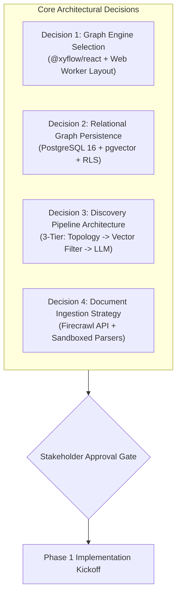

# 13. Decisions Requiring Approval and Open Questions

## 1. Architectural Decisions Summary

During Phase 0, the engineering and product team evaluated critical trade-offs to establish a coherent, robust foundation for Web of Thoughts. Below are the key architectural decisions reached, alongside the specific items requiring explicit stakeholder sign-off prior to Phase 1 implementation.

---

## 2. Five Critical Decisions Requiring Explicit User Approval

### Decision 1: Graph Visualization Engine
* **Proposal:** Use **`@xyflow/react` (React Flow v12)** as the primary canvas engine, paired with **`graphology`** in a Web Worker for automatic force-directed layout computation.
* **Why this choice:** React Flow allows every node to be a full, interactive React component featuring rich typography, badges, action buttons, progress bars, and citation drawers. Pure WebGL engines (Sigma/Cytoscape) can render 50,000 nodes, but make rich interactive cards virtually impossible to style cleanly.
* **Trade-off:** Canvas viewport is optimized for graphs of up to 1,500 interactive nodes simultaneously. For massive repositories, we implement spatial clustering and Level-of-Detail (LOD) node culling.
* **Status:** **PENDING USER APPROVAL**.

---

### Decision 2: Database and Backend Architecture
* **Proposal:** Standardize on **PostgreSQL 16 via Supabase** utilizing `pgvector` for vector embeddings, recursive CTEs for graph traversals, and Row-Level Security (RLS) for tenant isolation.
* **Why this choice:** Avoids the operational overhead of running a separate NoSQL graph database (Neo4j) alongside a separate vector database (Pinecone). Postgres handles relational data, graph traversals, vector similarity, and user authentication in a single ACID-compliant, open-source engine.
* **Trade-off:** Very deep multi-hop traversals ($> 6$ hops) require recursive CTE optimization.
* **Status:** **PENDING USER APPROVAL**.

---

### Decision 3: Foundation Model Strategy & Provider Abstraction
* **Proposal:** Implement a multi-provider AI abstraction layer supporting **Anthropic Claude 3.5 Sonnet** and **Google Gemini 1.5 Pro**, with support for user-supplied API keys (BYOK) and client-side ONNX embeddings for local search.
* **Why this choice:** Claude 3.5 Sonnet and Gemini 1.5 Pro demonstrate the highest empirical reasoning and citation-grounding accuracy. The abstraction prevents vendor lock-in.
* **Trade-off:** Requires maintaining prompt adapters and parsing logic across two provider schemas.
* **Status:** **PENDING USER APPROVAL**.

---

### Decision 4: Document & Web Scraping Strategy
* **Proposal:** Utilize **Firecrawl API** for web and complex PDF ingestion in Scope B, while providing basic server-side text/markdown parsers for Scope A.
* **Why this choice:** Modern web pages and complex multi-column academic PDFs contain headers, ads, navigation bars, and dynamic scripts that corrupt LLM concept extraction. Firecrawl converts dirty web URLs into token-optimized Markdown.
* **Trade-off:** Firecrawl cloud requires an API key or self-hosted Docker container in production.
* **Status:** **PENDING USER APPROVAL**.

---

### Decision 5: Scope A MVP Boundary
* **Proposal:** Confirm the exact feature boundary for the **Scope A Minimum Working Product**:
  1. Frictionless idea capture (plain text, markdown).
  2. Automated concept and typed relationship extraction.
  3. Interactive 2D knowledge canvas with zoom/pan and node inspection.
  4. 3-Tier Discovery Engine generating ranked cross-domain candidate cards with explanations.
  5. Evidence Explorer displaying exact verbatim source excerpts.
  6. Discovery Lab MVP: 1 hypothesis formulation, 1 experiment validation plan with metrics, and empirical outcome recording.
  7. Graph Evolution Reconciliation: Updating edge status from `proposed` to `accepted` or `rejected` based on experiment results.
* **Trade-off:** Scope A strictly omits PDF uploads, automated web crawling, 3D galaxy rendering, and multi-user collaboration to ensure rapid, rock-solid delivery of the core value proposition.
* **Status:** **PENDING USER APPROVAL**.

---

## 3. Open Design and Research Questions

1. **User Notification Frequency for Proactive Discoveries:** Should discoveries appear as a subtle notification badge in the sidebar, or should the canvas automatically illuminate newly discovered bridge edges when the user opens the application? *(Recommendation: Subtle badge counter in navigation with an optional "Discoveries" canvas overlay filter).*
2. **Concept Granularity Control:** How should the extraction prompt handle concept hierarchy (e.g., extracting "Machine Learning" vs. "Stochastic Gradient Descent")? *(Recommendation: Implement a two-tiered concept tag: `DomainCategory` for macro clustering, and `AtomicConcept` for specific entities).*
3. **Local-First Synchronization:** Should Web of Thoughts support complete offline SQLite syncing (via CRDTs/ElectricSQL) in the future? *(Recommendation: Deferred to Scope C; Postgres + Supabase RLS satisfies all current privacy and multi-device requirements).*
